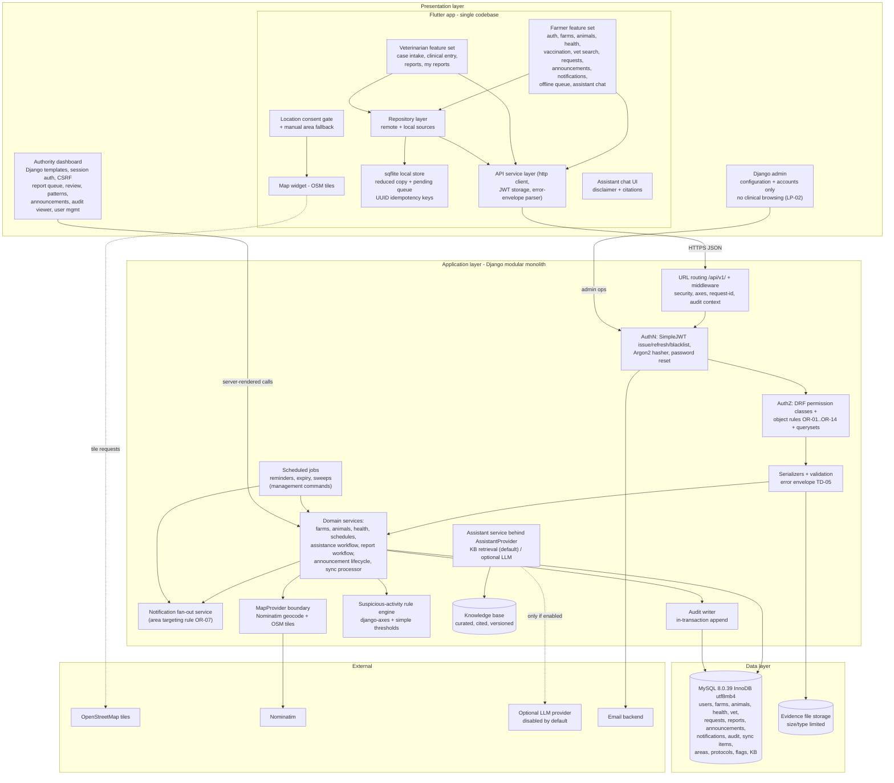
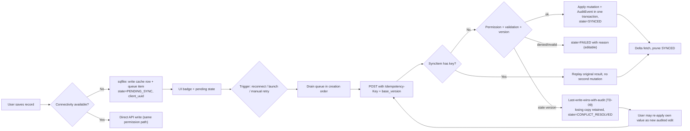
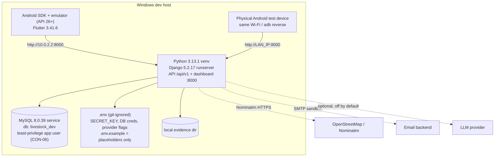
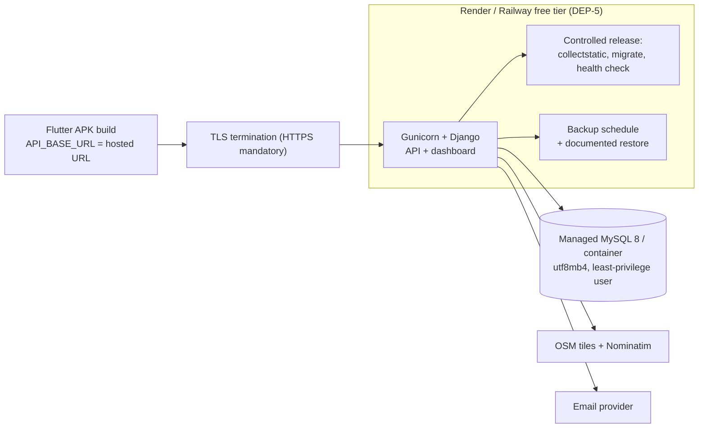

# Architecture Overview

| Field | Value |
|---|---|
| Project | Smart Livestock Health and Farm Management System |
| Document ID | DOC-REQ-009 |
| Title | System Architecture Overview (Phase 0, preliminary) |
| Version | 0.1 |
| Date | 2026-11-04 |
| Author | Member A (backend-facing requirements); mobile boundaries reviewed by Member B |
| Status | Draft for Phase 0 review |
| Parent documents | DOC-REQ-001 charter (§4, §10 `TD-01`..`TD-14`), DOC-REQ-002 SRS (ARC-1..ARC-9, §3.1 context) |
| Companion documents | DOC-REQ-004 data/ERD plan, DOC-REQ-005 API requirements, DOC-REQ-006 security/threat model, DOC-REQ-010 access-control matrix, DOC-REQ-011 UI inventory, DOC-REQ-012 release plan, DOC-REQ-014 test plan |
| Master-prompt step | Phase 0, Step 0.6 "Prepare the design documents" (architecture, deployment, navigation) |

---

## 1. Scope and status of this document

This is a **requirements-phase** architecture: it fixes component boundaries, the request lifecycle, the authentication and synchronisation mechanisms, the deployment topology for the academic demonstration, and the architectural guarantees that non-functional requirements depend on. It contains no implementation and no new dependencies.

The technology choices are already recorded in DOC-REQ-001 §10 (`TD-01`..`TD-14`) and are **not** re-decided here; this document explains how they fit together and adds only architecture-level supplements (`AD-01`..`AD-10`, §9). Anything that would add a technology not in the charter requires a documented reason and supervisor approval (master prompt, Phase 1: "do not add unnecessary technologies").

Environment pins assumed throughout (CON-02): Python 3.13.1, Django 5.2.17, Flutter 3.41.6, MySQL 8.0.39, Windows development hosts, Android target API 26+.

## 2. Architectural style

| Aspect | Decision | Why |
|---|---|---|
| Overall style | Layered, client–server with a single authoritative application layer | Matches README §7 and keeps policy in one place (ARC-1) |
| Backend shape | **Modular monolith**: one Django project containing the DRF API and the Django-template authority dashboard, split into domain apps | Shares models, permissions and audit code with zero duplication; avoids a second authentication stack (TD-13, AD-01) |
| API shape | Resource-oriented REST under `/api/v1/`, DRF ViewSets + routers, page size 20, `django-filter`, drf-spectacular OpenAPI (TD-04) | The OpenAPI schema is the mobile contract (CON-09) |
| Mobile shape | Flutter app, feature-first folder structure, thin HTTP service layer generated/aligned against the OpenAPI contract, local sqflite store behind a repository interface | Testable offline logic, single place to change transport (AD-02/AD-03) |
| State | Server is the only source of truth; the device holds a reduced, encrypted, logout-wiped copy (ARC-6, `BR-14`) | Limits device-loss exposure (SC/`NF-PRIV`) |
| AuthN for API | Stateless JWT access + refresh with blacklist on logout (TD-01) | Mobile-friendly, testable revocation |
| AuthN for dashboard | Django session cookies, CSRF-protected (TD-13) | Server-rendered staff tool; no token handling in templates |
| Coupling rule | Clients never talk to MySQL; only the application layer touches the database | Single enforcement point |
| Automation rule | Scheduled work and fan-out run in-process (management commands + a scheduler on the host), not through a broker | No Redis/RabbitMQ dependency for an academic deployment (AD-04) |

### 2.1 Explicit non-components

Not in the architecture, by exclusion: payment gateway, IoT/sensor ingestion, national disease-system integration, real-time chat, SMS/USSD gateway, FCM push, event-sourcing store, ML forecasting service, multi-tenant billing (EXCL-01..EXCL-13). Each is a documented future-work item, so a reviewer can confirm the absence is deliberate rather than an omission.

## 3. Three layers

| Layer | Components | Technology | Responsibility | Must not |
|---|---|---|---|---|
| **Presentation** | Farmer mobile app; Veterinarian mobile app (same Flutter codebase, role-routed); Authority dashboard; Django admin (configuration only) | Flutter 3.41.6 / Dart; Django templates + HTML/CSS/JS | Render state, collect input, show loading/empty/error/offline states (DOC-REQ-011), hold the offline queue | Decide authorisation, hide a permission bug, hold the source of truth |
| **Application** | DRF API; auth & RBAC; object-permission layer; domain services (schedule derivation, report workflow, announcement lifecycle, notification fan-out, sync processor, assistant service); audit writer; rule engine; geocoding proxy | Python 3.13, Django 5.2.17, DRF, SimpleJWT, argon2-cffi, django-axes, django-filter, drf-spectacular | Validate input, enforce DOC-REQ-010, run business rules, emit audit events, version announcements | Trust client-supplied role/ownership claims; publish via automation (ARC-3) |
| **Data** | MySQL 8.0.39 (InnoDB, `utf8mb4`, UTC storage); device SQLite (`sqflite`); KB content store (DB-backed, versioned); file storage for evidence uploads (local disk in dev, object storage only if funded) | MySQL, SQLite, Django storage API | Persist durable state, constraints, idempotency ledger, append-only audit | Be reachable directly from clients; store secrets |

External boundaries (behind interfaces, per ARC-8): OSM raster tiles + Nominatim geocoding (`MapProvider`, TD-08), optional external LLM (`AssistantProvider`, TD-10), email backend for password reset.

## 4. Component diagram



### 4.1 Backend app decomposition (target layout)

Follows README §8; the dashboard lives in the same Django project (TD-13), so no separate `web/` application is created.

| Django app | Contents | Main objects |
|---|---|---|
| `accounts` | custom `User`, profiles, roles, sub-roles, verification, JWT endpoints, password reset | `User`, `FarmerProfile`, `VeterinarianProfile`, `AuthorityProfile` |
| `farms` | farm registry, area reference data | `Farm`, `Area` |
| `livestock` | animal identity, inventory, status | `Animal` |
| `health_records` | generic events, vaccinations, treatments, visits, protocols, schedules | `HealthRecord`, `VaccinationRecord`, `VaccinationSchedule`, `VaccinationProtocol`, `TreatmentRecord`, `VeterinaryVisit` |
| `veterinary` | directory, search, assistance requests, access grants | `AssistanceRequest`, `AccessGrant` |
| `disease_reports` | reports, status machine, pattern summaries | `DiseaseReport`, `AuditEvent` transition rows |
| `announcements` | announcement lifecycle and versions | `OutbreakAnnouncement`, `AnnouncementVersion` |
| `notifications` | recipient inboxes | `Notification` |
| `audit` | append-only events, flag store | `AuditEvent`, `SuspiciousActivityFlag` |
| `sync` | idempotency ledger, replay handling | `SyncItem` |
| `assistant` | KB, provider interface, answer log | `KbEntry`, `AssistantExchange` |
| `dashboard` (in-project) | Django templates + views for authority/admin staff | report queue, review detail, announcement composer, monitoring, audit viewer, user management |

`tests/` at repository root holds cross-cutting scripts; per-app tests live next to the code (`backend/<app>/tests/`).

## 5. Request lifecycle

Every API request follows the same path; the numbered steps are the checklist used by `TC-PERM-*` and `TC-SEC-*` tests (DOC-REQ-014).

1. **Transport**: HTTPS to `/api/v1/...` (TLS in any deployed environment; plain HTTP only on loopback in development).
2. **Middleware**: security headers, request-id capture, `django-axes` login throttling hooks, audit-context population (actor, IP, user agent, request id).
3. **Authentication**: JWT access token decoded; expired or blacklisted token → 401 with the standard error envelope (TD-05).
4. **Role gate**: DRF permission class checks the role-level allowance from DOC-REQ-010 §4. Failure → 403, and per OR-12 an access-control `AuditEvent` when an object identifier was targeted.
5. **Object gate**: `get_queryset()` is already scoped by owner / assignment / jurisdiction; object rules OR-01..OR-14 re-evaluate the target row. A resource that exists but is not visible returns 404 by policy (no existence disclosure) — enumerated in DOC-REQ-005.
6. **Validation**: serializer field-level and cross-field validation; unknown/un_permitted fields (for example `role`) are rejected, never ignored silently (OR-10).
7. **Domain service**: business rule execution inside `transaction.atomic()` — report state machine, schedule derivation, announcement versioning, sync replay with idempotency check.
8. **Audit write**: `AuditEvent` inserted in the same transaction as the mutation (ARC-5, BR-18). A failed audit insert rolls the mutation back (decision Q7, DOC-REQ-008 §10).
9. **Side effects queued**: notification fan-out, expiry sweeps and flag creation happen through services invoked after commit; failures are recorded and retried, never silently swallowed.
10. **Response**: consistent envelope, page size 20, filter/sort/pagination contract per CON-09; OpenAPI schema is the authority for the shape.
11. **Logging**: structured server log line with request id, actor, outcome and duration; no passwords, tokens, precise coordinates or clinical payload text in logs (CON-06).

Dashboard requests take the same path from step 4 onward, substituting session authentication and CSRF checks for JWT (TD-13); template views call the same domain services and permission helpers as the API, so a rule is implemented once (AD-01).

## 6. Authentication and authorisation flow

```mermaid
sequenceDiagram
    autonumber
    participant U as User (Flutter / dashboard browser)
    participant API as DRF auth endpoints
    participant AUTH as Django auth + Argon2 hasher
    participant AX as django-axes
    participant JWT as SimpleJWT
    participant DB as MySQL
    participant AUD as Audit writer
    U->>API: POST /api/v1/auth/login (identifier, password)
    API->>AX: is login allowed for this identity/IP?
    alt locked or throttled
        AX-->>API: blocked
        API-->>U: 423/429 standard error envelope
        API->>AUD: AuditEvent auth_failure_locked
    else allowed
        API->>AUTH: authenticate(password) - Argon2 verify (TD-02)
        alt invalid credentials
            AUTH-->>API: failure
            API->>AX: record failure
            API->>AUD: AuditEvent auth_failure (never logs the password)
            API-->>U: 401 generic invalid_credentials (no account disclosure)
        else valid, account active, role resolved
            AUTH-->>API: user + role
            API->>JWT: issue access token (short TTL) + refresh token (longer TTL)
            API->>DB: persist AuditEvent auth_success
            API-->>U: 200 {access, refresh, role, must_change_password}
            U->>API: GET /api/v1/animals/ Authorization Bearer access
            API->>JWT: decode + signature/expiry check
            API->>API: role gate then object rules OR-01..OR-14
            API-->>U: 200 scoped page (size 20)
            U->>API: POST /api/v1/auth/logout (refresh token)
            API->>JWT: blacklist refresh (TD-01)
            API->>DB: AuditEvent logout
            API-->>U: 204; device wipes local SQLite copy (ARC-6)
        end
    end
```

Notes binding this flow to requirements (all provisional `FR-AUTH` links, DOC-REQ-002):

1. Role is a property of `User` and is embedded in the token claims by server logic only; clients cannot assert a role (OR-10, AS-04).
2. Access-token TTL and refresh rotation parameters are numeric values fixed in DOC-REQ-002/006 so tests can assert them (ARC-7).
3. Password reset issues a tokenised email link (external boundary: SMTP); reset tokens are single-use and expire.
4. Lockout threshold/lock duration come from the suspicious-activity policy (TD-07, DOC-REQ-006/007); lockout is a signal for review, not a finding (D-11).
5. Dashboard session auth and API JWT auth resolve the **same** `User`/role/permission objects — no parallel permission implementation.

## 7. Offline synchronisation flow (architecture view)

The workflow-level view, including the user-facing conflict UX, is UC-10 in DOC-REQ-008. The architectural mechanism is:

1. **Local write**: the repository writes the mutation plus metadata (`client_uuid`, `entity_type`, `operation`, `payload`, `base_version`, `created_at`, `state`) into the sqflite queue and the reduced local cache. Only offline-eligible entity types are admitted (DOC-REQ-002 `FR-OFF` list).
2. **Queue drain**: on connectivity restore/app launch/manual retry, items are sent in creation order, one request per item, each carrying the idempotency key (`D-12`) and `base_version`.
3. **Server dedup**: `SyncItem` is unique on (`user_id`, `client_uuid`). A repeat of an existing key returns the original outcome without a second mutation — this is what SC-04 asserts.
4. **Apply**: the same permission path as an online write (§5 steps 4-8) runs, so an offline entry never bypasses a rule; the audit row records `origin = offline_sync`.
5. **Version check**: if `base_version` is stale, TD-09 applies: **last-write-wins-with-audit**. The newest value is applied, the losing copy is preserved in the audit change summary, and the response carries both values plus a conflict marker.
6. **Client state**: the item becomes `SYNCED`, `FAILED` (validation reason surfaced, retryable after edit) or `CONFLICT_RESOLVED` (both values visible; the user may re-apply their value as a fresh audited edit). Nothing is discarded silently.
7. **Reconciliation**: a delta fetch (`?changed_since=`, page size 20) refreshes the local cache; pruning removes only `SYNCED` rows.
8. **Security boundaries**: the local copy is encrypted where the chosen sqflite/encryption package installs on the target API levels, is limited to permitted fields, and is wiped on logout (ARC-6, `BR-14`, Q6 in DOC-REQ-008 §10 — a sync attempt is forced and the user warned before the wipe).
9. **Failure envelope**: retry with exponential backoff and a maximum attempt count; permanent failures stay in the queue with the reason; the queue badge count equals pending + failed + conflict items (US-FARMER-18).



## 8. Data flows for the sensitive features

### 8.1 GPS / location (BR-06, FR-VET-02, OR-13)

1. Feature requests location → the consent gate renders purpose, precision (coarse vs precise), retention and withdrawal path **before** any permission prompt or network call.
2. Consent refused, GPS unavailable, or low-confidence fix → manual area selection from `Area` reference data; functionally equivalent (SC-06).
3. Consent granted → device fix + accuracy → `MapProvider` boundary resolves a **coarse area** (`D-15`) via Nominatim; the precise fix is used transiently and discarded unless the user opts into precise disclosure to a named counterparty.
4. Persisted values: `Area`/coarse area on farm, request, report; precise coordinate only in the consented, purpose-bound column defined by DOC-REQ-004, readable per OR-13.
5. Map tiles are fetched client-side from OSM (fair-use, AS-07); geocoding is proxied server-side where practical so provider switching (Google Maps fallback, TD-08/DEP-1) does not require an app release.
6. Audit: consent grant, withdrawal, and any precise-coordinate read.
7. Rate/abuse control: geocoding calls are cached per area query and rate-limited (DOC-REQ-006).

### 8.2 AI information assistant (BR-25, ARC-8)

```mermaid
flowchart LR
    Q["Question from chat UI"] --> V["Sanitise + classify topic<br/>(refusal list: diagnosis, dosage)"]
    V --> R{"Blocked topic?"}
    R -- "Yes" --> RF["Refusal answer + vet-contact action"]
    R -- "No" --> RET["KB retrieval<br/>curated, cited, versioned entries"]
    RET --> M{"AssistantProvider mode"}
    M -- "kb_only (default, AS-08)" --> KA["Answer composed from KB + citations"]
    M -- "llm_enabled (optional, DEP-4)" --> LA["LLM phrasing over KB context only"]
    LA --> G{"LLM available?"}
    G -- "No / over quota" --> KA
    G -- "Yes" --> CHK["Safety post-check:<br/>no diagnosis, no dosage, disclaimer, citations present"]
    KA --> CHK
    CHK --> OUT["Response: answer + citations + disclaimer + mode metadata"]
    OUT --> LOG[("AssistantExchange log, no farm identifiers (QF)")]
    OUT --> RED["Red-flag topic -> Assistance Request Form action"]
    CHK -. "no write path to business objects (OR-09)" .-> STOP["Forbidden by design"]
```



Guarantees asserted by tests (SC-05): every response carries the disclaimer and source or fallback metadata; zero business-object writes originate from this path; automation cannot publish (LP-07).

### 8.3 Notifications (pull-based inbox)

1. Triggers: schedule reminder job, assistance status transitions, report status transitions, announcement publication/withdrawal/expiry.
2. Recipients are computed by the targeting rule OR-07 (area-set intersection) in code, never typed by an officer.
3. `Notification` rows are created in the recipient's inbox with type, actor-free payload reference and deep-link target.
4. Delivery is **pull**: the app fetches unread notifications on launch/foreground refresh; push transport behind the `NotificationTransport` seam is deferred (EXCL-09; FR-NOTIF-07 seam ships unimplemented), SMS/email deferred (EXCL-08) — a documented limitation, not an oversight.
5. Fan-out failures are recorded per recipient, visible in the dashboard monitoring view, and retried by the sweep (US-AUTH-06).

## 9. Architecture-level decisions (supplements to `TD-*`)

| ID | Decision | Choice | Alternatives rejected | Consequence | Revisit if |
|---|---|---|---|---|---|
| AD-01 | One deployable serving both API and staff dashboard | Modular monolith, shared permission layer | Separate dashboard SPA with its own auth | No rule duplication; session + JWT coexist; slightly larger deployable | Permission drift observed between surfaces |
| AD-02 | Single Flutter codebase, role-routed navigation for Farmer and Veterinarian | Same app, feature folders gated by role claims | Two apps; one app with dead code | One build, one test matrix; role routing must be server-enforced anyway | User cohort demands divergent UX |
| AD-03 | Repository pattern with remote + sqflite sources | `remote/local/repository` split; UI never calls HTTP directly | Ad-hoc `Dio` calls in widgets | Offline logic unit-testable in Dart; API swap contained | — |
| AD-04 | Scheduled work via management commands + host scheduler | `reminders`, `announcement_expiry`, `grant_expiry_sweep`, `notification_retry` | Celery + broker | Zero extra infrastructure for a demo scale (honest limitation: no distributed workers) | Real deployment needs sub-minute delivery |
| AD-05 | Flutter state management | `provider` + `ChangeNotifier` per feature (proposal; confirm in Phase 1 spike) | riverpod, bloc,GetX | Low ceremony for a 2-person team; testable view models | Spike shows scaling pain in Phase 3 |
| AD-06 | Idempotency ledger unique on (user, client_uuid) | `SyncItem` table | Header-only dedup with TTL cache | Deterministic duplicate prevention, inspectable in tests | — |
| AD-07 | Geocoding proxied server-side behind `MapProvider` | Server proxy + client tile fetch | Fully client-side geocoding | Provider switch without app release; hides keys; adds a hop | Latency budget missed (NF-PERF) |
| AD-08 | KB stored in MySQL, versioned rows, seeded by fixture | `KbEntry` with version + source citation | Vector database; file-based JSON only | No new infrastructure; curation is an admin operation with audit | Corpus grows past simple retrieval quality |
| AD-09 | Existence-hiding policy: invisible objects return 404, forbidden-but-visible return 403 | Documented in DOC-REQ-005 error contract | Uniform 403 | Prevents identifier enumeration (AC-N-01) | — |
| AD-10 | Evidence uploads to private storage, size/type allowlist, no public URLs | Django storage API, local disk in dev | Public media folder; base64 in payloads | Confidentiality preserved; simple ops | Real deployment requires CDN/signed URLs |

## 10. Deployment topology

### 10.1 Development (primary, used for the academic build and demo)



Characteristics: single host, loopback/LAN HTTP acceptable only here, HTTPS off; the health-check endpoint verifies DB connectivity; the same settings module with `DEBUG=False` variants is used for the production-like path so configuration differences stay small.

### 10.2 Production-like option (optional, for Phase 8)



Constraints accepted for the academic demonstration: free-tier spin-down adds cold-start latency to the first request (mitigation in DOC-REQ-013 `RSK-17`: demo on the local build, hosted build as supplementary evidence); free-tier MySQL may be unavailable, in which case the documented fallback is a container or the university server (DEP-5, DEP-7); APK distribution is a direct artefact — store publication is not planned (EXCL-07 covers iOS).

### 10.3 Environment/secret boundaries

| Environment | Config source | Transport | Data | Notes |
|---|---|---|---|---|
| Developer machine | `.env` (TD-12) | HTTP loopback/LAN | Synthetic fixtures only | `.env` git-ignored; `.env.example` placeholders |
| CI (if added in Phase 1) | Secrets at pipeline level | HTTPS service containers | Synthetic | Never echoes secret values in logs |
| Staging/demo host | Platform env vars, no repo file | HTTPS enforced | Synthetic for demo; any real data requires supervisor/ethics approval (AS-09) | Backup + restore drill before acceptance (SC-08) |

## 11. Trust boundaries and enforcement summary

| Boundary | What crosses it | Control that must hold | Verified by |
|---|---|---|---|
| Device → API | JWT calls, queued mutations | TLS in deployed envs, token validation, rate limiting, axes lockout | `TC-SEC-*` |
| API → permission layer | Every request | Role gate AND object rule (OR-01..OR-14); default deny | `TC-PERM-*` (§8 DOC-REQ-010) |
| Permission layer → data | Query-sets | Scoping applied at queryset level, not post-filter | Model/queryset tests |
| Application → external providers | Geocode, optional LLM, email | Provider interfaces with fallbacks; no farm identifiers sent to LLM (NF-PRIV) | `TC-PRIV-*`, `TC-AI-*` |
| Human authority → announcement | Publish action | Only officer human session may set `PUBLISHED` (LP-07) | Negative publication tests |
| Any role → audit | Read | Append-only, restricted, no secrets in rows | `TC-PERM-19`, log-content assertions |

**Non-functional guarantees that this architecture exists to provide** (requirement links provisional, DOC-REQ-002):

1. **Server-side permission enforcement; no client-only checks** (ARC-1, CON-04, BR-16). UI gating is cosmetic; every DOC-REQ-010 grant is an `EP-*` in the application layer, and `AC-N-14` (reaching a hidden action directly) is a required test.
2. **Human-only official publication** (ARC-3) — no code path sets `PUBLISHED` without a human officer principal.
3. **Attributability** — mutation + audit in one transaction; rollback otherwise (ARC-5, Q7).
4. **Data minimisation on the device** (ARC-6) — reduced encrypted copy, logout wipe.
5. **Consent-based location with an equivalent manual path** (BR-06/FR-VET-02, SC-06).
6. **Determinism** — numeric TTLs, thresholds, page size, retry counts, conflict rule (ARC-7) so assertions can be written.
7. **Availability** — degraded modes for geocoding, LLM and offline operation (ARC-8, DEP-1, DEP-4); no paid service required for acceptance (CON-08).
8. **Performance** — read-only API p95 below 500 ms at page size 20 on 10k synthetic animals (SC-07), measured on the development topology, reported honestly with its limits.
9. **Recoverability** — scheduled dumps plus one restore drill (SC-08, NF-REL).
10. **Usability** — every screen in DOC-REQ-011 has defined loading/empty/error/offline states (NF-USE).

## 12. Known architectural limitations (for the final report)

1. Single-host modular monolith; no horizontal scaling story, by design at academic scale.
2. Pull-based notifications only (EXCL-09) — an officer cannot rely on sub-minute reach.
3. In-process scheduled jobs (AD-04) mean reminder precision depends on host uptime.
4. Last-write-wins-with-audit avoids merge complexity but cannot express field-level merges (TD-09, `RSK-05`).
5. Free-tier hosting cold starts and MySQL availability are external dependencies (DEP-5, DEP-7).
6. KB-only assistant quality is bounded by curation effort (AS-08, DEP-4).
7. Geocoding accuracy for rural areas may be poor; manual area selection is the mitigation, not a perfect substitute (`RSK-04`).

## 13. Diagram inventory produced from this document (Phase 1 design follow-up)

| Diagram | Home | Status |
|---|---|---|
| Component diagram (§4) | This document | Drafted |
| Request lifecycle (§5) | This document | Drafted |
| Auth flow (§6), sync flow (§7), GPS/AI/notification flows (§8) | This document | Drafted |
| Deployment topology (§10) | This document | Drafted |
| Use-case diagram | DOC-REQ-008 / `docs/01_design/` | Pending — derive from UC-01..UC-12 |
| ERD | DOC-REQ-004 | Pending (Member A) |
| API resource catalogue | DOC-REQ-005 | Pending (Member A) |
| Navigation flow | DOC-REQ-011 | Drafted (§7 of that document) |
