# Data Requirements and ERD Plan

| Field | Value |
|---|---|
| Project | Smart Livestock Health and Farm Management System |
| Document ID | DOC-REQ-004 |
| Version | 0.1 |
| Date | 2026-11-04 |
| Authors | Group 10 — Member A (backend/dashboard) |
| Status | Draft for Phase 0 review |
| Phase | Phase 0 — Requirements Assessment and Project Planning |
| Related | DOC-REQ-002 (SRS), DOC-REQ-003 (business rules), DOC-REQ-005 (API), DOC-REQ-006 (security), DOC-REQ-007 (audit/AI policy) |

---

## 1. Scope of this document

This document specifies Phase 0 data requirements: entity inventory, relationships with
cardinalities, key fields, index requirements, the ERD in Mermaid form with a text fallback, and the
MySQL-specific decisions. It is a plan, not a migration: no schema is created until Phase 2, and the
final column set may be refined then provided every change is traced back to a requirement here.

Design principles (from DOC-REQ-002 §3.2):

| ID | Principle |
|---|---|
| DP-1 | One identity table (`accounts_user`), one role per user, role data in per-role profile tables |
| DP-2 | Real foreign key constraints with explicit `on_delete` behaviour; no orphan rows tolerated |
| DP-3 | No hard deletion of clinically or evidentially relevant rows — soft archive plus status |
| DP-4 | Timestamped soft history: mutable current values plus `AuditEvent` change summaries; no separate event-store tables |
| DP-5 | UTC storage, `BigInteger` surrogate PKs, short natural keys where a business rule needs uniqueness |
| DP-6 | Derived access (veterinarian clinical visibility) is computed from workflow tables, not stored as a standing privilege, except for the optional explicit grant |
| DP-7 | Location is split: always-available coarse `area_id` FK, and separately stored precise coordinates that are null unless consent exists |

---

## 2. Entity inventory

| ID | Entity | Table (proposed) | Purpose | Owning module | Requirements |
|---|---|---|---|---|---|
| M-01 | `User` | `accounts_user` | Custom auth user: identity, single role, active flag, hashing | accounts | FR-AUTH-01..16 |
| M-02 | `FarmerProfile` | `accounts_farmer_profile` | Farmer-specific attributes | accounts | FR-AUTH-10 |
| M-03 | `VeterinarianProfile` | `accounts_vet_profile` | Practice name, practice area, species expertise, licence and verification | accounts | FR-AUTH-14, FR-VET-04 |
| M-04 | `AuthorityProfile` | `accounts_authority_profile` | Jurisdiction plus reviewer/officer subrole | accounts | FR-AUTH-13 |
| M-05 | `Area` | `geo_area` | Maintained coarse area vocabulary (region/district tree) | farms | FR-FARM-05, FR-ANN-07 |
| M-06 | `ConsentRecord` | `privacy_consent` | Purpose-scoped, revocable consent (location granularities) | accounts | FR-AUTH-03, BR-06 |
| M-07 | `Farm` | `farms_farm` | Farmer's farm, coarse area, optional precise point, archive status | farms | FR-FARM-01..07 |
| M-08 | `Animal` | `livestock_animal` | Registered livestock with identity and status | livestock | FR-ANIM-01..09 |
| M-09 | `HealthRecord` | `health_health_record` | Generic timestamped animal health event with soft history | health | FR-HEALTH-01/02/03/09 |
| M-10 | `VaccinationSchedule` | `health_vacc_schedule` | Planned dose obligation with due date and recurrence | health | FR-HEALTH-04 |
| M-11 | `VaccinationRecord` | `health_vacc_record` | Administered dose evidence | health | FR-HEALTH-04 |
| M-12 | `TreatmentRecord` | `health_treatment` | Medicine, dosage text, route, dates, prescriber | health | FR-HEALTH-05 |
| M-13 | `VeterinaryVisit` | `vet_visit` | Recorded vet visit; grants clinical visibility | veterinary | FR-HEALTH-06 |
| M-14 | `AssistanceRequest` | `vet_assistance_request` | Farmer-to-vet request with status workflow | veterinary | FR-VET-05..14 |
| M-15 | `DiseaseReport` | `reports_disease_report` | Vet-authored suspected-disease report with review workflow | reports | FR-REPORT-01..12 |
| M-16 | `OutbreakAnnouncement` | `announcements_outbreak` | Official notice with publication lifecycle | announcements | FR-ANN-01..12 |
| M-17 | `Notification` | `notify_notification` | Per-recipient in-app message | notifications | FR-NOTIF-01..06 |
| M-18 | `AuditEvent` | `audit_event` | Append-only actor/action/target/timestamp/change summary | audit | BR-18, POL-AUDIT |
| M-19 | `SyncItem` | `sync_item` | Idempotency keys and processed-mutation metadata | sync | FR-OFF-03/04/05 |
| M-20 | `Attachment` | `media_attachment` | Validated evidence file metadata plus storage path | health | FR-HEALTH-08, BR-30 |
| M-21 | `SuspiciousActivityFlag` | `audit_sus_flag` | Rule-generated review item with outcome | audit | BR-11, BR-32, POL-SUS |
| M-22 | `AssistantInteraction` | `assistant_interaction` | Question, answer, citations, source label, safety flags | assistant | FR-AI-13/15 |
| M-23 | `KBSource` | `assistant_kb_source` | Curated, cited, versioned reviewed knowledge-base entry | assistant | FR-AI-03 |
| M-24 | `FarmVetGrant` (Could) | `farms_vet_grant` | Optional standing farmer-to-vet farm access grant | farms | FR-FARM-08 |
| M-25 | `BlacklistedToken` (library) | `token_blacklist_blacklistedtoken` | Refresh-token revocation, supplied by simplejwt | accounts | FR-AUTH-03 |

Notes on deliberately absent tables:

1. No `VetAssignment` table: visibility derives from `AssistanceRequest` and `VeterinaryVisit`
   (DP-6). `FarmVetGrant` exists only if FR-FARM-08 (Could) is scheduled.
2. No `DiseaseReportStatusHistory` table: transitions are recorded in `AuditEvent` (action
   `report.transition`) with old/new status, reason and actor; the report keeps
   `status`, `status_updated_at`, `status_updated_by`.
3. Clarification question/answer exchanges are stored append-only in a JSON column
   (`clarification_log`) on `DiseaseReport`, and each exchange is mirrored into `AuditEvent`. This
   avoids a table whose only purpose is a two-field message while preserving evidence. If query
   volume later demands it, it becomes its own table with no contract change.
4. Announcement versions: the current row holds the live version; previous content is retained in
   `AuditEvent.after_image/before_image`. An explicit `AnnouncementVersion` table is the fallback if
   officers need to diff versions in the UI (FR-ANN-12, Should).

---

## 3. Relationships and cardinalities

Notation: `1..1` mandatory one, `0..1` optional one, `1..N` one-to-many, `M..N` many-to-many.

| # | Parent | Child | Cardinality | FK / join | On delete | Rule |
|---|---|---|---|---|---|---|
| R-01 | `User` | `FarmerProfile` | 1..1 to 1..1 (farmer users only) | `user OneToOne` | `CASCADE` blocked by BR-16 (no hard user delete) | Exactly one profile per role; DP-1 |
| R-02 | `User` | `VeterinarianProfile` | 1..1 | `user OneToOne` | as above | FR-AUTH-10 |
| R-03 | `User` | `AuthorityProfile` | 1..1 | `user OneToOne` | as above | FR-AUTH-13 |
| R-04 | `Area` | `User` (profile area) | 1..N | `area_id` nullable | `SET_NULL` | Preference area only |
| R-05 | `Area` | `Area` (self) | 1..N | `parent_id` nullable | `CASCADE` within vocabulary | Region/district tree |
| R-06 | `User` (farmer) | `Farm` | 1..N | `owner_id` | `PROTECT` | BR-01; farm never orphaned |
| R-07 | `Area` | `Farm` | 1..N | `area_id` | `PROTECT` | Coarse location mandatory (FR-FARM-01) |
| R-08 | `Farm` | `Animal` | 1..N | `farm_id` | `PROTECT` | Soft archive only (FR-ANIM-06) |
| R-09 | `Animal` | `HealthRecord` | 1..N | `animal_id` | `PROTECT` | History must survive |
| R-10 | `User` | `HealthRecord` (author) | 1..N | `author_id` | `PROTECT` | Authorship accountability (FR-HEALTH-01) |
| R-11 | `Animal` | `VaccinationSchedule` | 1..N (or farm-scoped via `farm_id`) | `animal_id` nullable, `farm_id` nullable, one required | `PROTECT` | FR-HEALTH-04 |
| R-12 | `VaccinationSchedule` | `VaccinationRecord` | 1..0..1 | `schedule_id` nullable | `SET_NULL` | Completing a schedule fills `status=COMPLETED` |
| R-13 | `Animal` | `VaccinationRecord` | 1..N | `animal_id` | `PROTECT` | Evidence of dose |
| R-14 | `Animal` | `TreatmentRecord` | 1..N | `animal_id` | `PROTECT` | FR-HEALTH-05 |
| R-15 | `HealthRecord` | `TreatmentRecord` | 0..1 to 0..N | `linked_health_record_id` nullable | `SET_NULL` | Treatment may reference a condition |
| R-16 | `Farm` | `VeterinaryVisit` | 1..N | `farm_id` | `PROTECT` | FR-HEALTH-06 |
| R-17 | `Animal` | `VeterinaryVisit` | N..M | `visit_animals` m2m join | `CASCADE` (join only) | Visit may cover a subset |
| R-18 | `User` (vet) | `VeterinaryVisit` | 1..N | `veterinarian_id` | `PROTECT` | Grants BR-02 visibility |
| R-19 | `Farm` | `AssistanceRequest` | 1..N | `farm_id` | `PROTECT` | FR-VET-05 |
| R-20 | `Animal` | `AssistanceRequest` | 0..N to 1..N | `animals` m2m | `CASCADE` (join only) | Animals must belong to the farm (AC) |
| R-21 | `User` (vet) | `AssistanceRequest` | 0..1 to 1..N | `veterinarian_id` nullable until assignment | `SET_NULL` | FR-VET-07 |
| R-22 | `VeterinaryVisit` | `AssistanceRequest` | 0..1 to 0..1 | `completed_request_id` | `SET_NULL` | Completion requires a visit (FR-VET-10) |
| R-23 | `User` (vet) | `DiseaseReport` | 1..N | `author_id` | `PROTECT` | BR-03 |
| R-24 | `Area` | `DiseaseReport` | 1..N | `affected_area_id` | `PROTECT` | Jurisdiction boundary (BR-08) |
| R-25 | `Farm` | `DiseaseReport` | 0..1 to 1..N | `farm_id` nullable | `SET_NULL` | Area-level reports allowed (FR-REPORT-02) |
| R-26 | `DiseaseReport` | `OutbreakAnnouncement` | 0..N to 0..N | `announcement_sources` m2m | `CASCADE` (join only) | Linking only; never converts (BR-23/28) |
| R-27 | `Area` | `OutbreakAnnouncement` | 1..N | `affected_areas` m2m | `CASCADE` (join only) | Targeting (FR-ANN-07) |
| R-28 | `User` (officer) | `OutbreakAnnouncement` | 1..N | `created_by`, `published_by`, `withdrawn_by` | `PROTECT` | BR-04, BR-24 |
| R-29 | `User` (recipient) | `Notification` | 1..N | `recipient_id` | `CASCADE` allowed — notifications are disposable | FR-NOTIF-01, BR-36 |
| R-30 | `User` (actor) | `AuditEvent` | 1..N plus `system` sentinel | `actor_id` nullable | `PROTECT` for real actors | BR-18, BR-33 |
| R-31 | Any | `AuditEvent` (target) | 1..N | `target_type`, `target_id` (polymorphic, no FK) | n/a | Deliberately non-FK so audit survives target archival |
| R-32 | `User` | `SyncItem` | 1..N | `user_id` | `PROTECT` | Idempotency scope (BR-20) |
| R-33 | `SyncItem` | `AuditEvent` | 1..0..1 | `audit_event_id` nullable | `SET_NULL` | Conflict evidence pointer (BR-19) |
| R-34 | Any record | `Attachment` | 1..N | polymorphic `content_type`, `object_id` | `CASCADE` (attachment is part of the record) | FR-HEALTH-08 |
| R-35 | `User` | `ConsentRecord` | 1..N | `user_id` | `PROTECT` | Consent history must be provable |
| R-36 | `RuleDefinition` (code constant) | `SuspiciousActivityFlag` | 1..N | `rule_key` string | n/a | POL-SUS rules are code-defined, not user-editable |
| R-37 | `User` | `AssistantInteraction` | 1..N | `user_id` | `SET_NULL` with anonymisation | FR-AI-13 |
| R-38 | `KBSource` | `AssistantInteraction` | N..M | `citations` JSON list of source ids plus version | n/a | Snapshot of citations preserved |
| R-39 | `Farm` | `FarmVetGrant` (Could) | 1..N | `farm_id`, `veterinarian_id` | `CASCADE` | FR-FARM-08 |

---

## 4. Entity detail: key fields and indexes

Common columns on every table (not repeated below): `id BIGINT AUTO_INCREMENT PK`,
`created_at DATETIME(6)` UTC, `updated_at DATETIME(6)` UTC. Soft-deletable tables add
`is_deleted BOOL default false`, `deleted_at DATETIME(6) NULL`, `deleted_by_id NULL`,
`deletion_reason VARCHAR(500)`. Versioned tables add `version INT default 1`.

### M-01 `User` (custom, `AbstractUser`)

| Field | Type | Notes |
|---|---|---|
| `email` | varchar(254) | unique, used for login |
| `username` | varchar(150) | kept from `AbstractUser`, auto-derived, unique |
| `password` | varchar(255) | Argon2 hash |
| `display_name` | varchar(120) | |
| `phone` | varchar(32) | nullable, formatted, RESTRICTED |
| `role` | varchar(20) | `FARMER`, `VETERINARIAN`, `AUTHORITY`, `ADMIN` |
| `is_active`, `is_staff`, `is_superuser` | bool | superuser reserved for break-glass |
| `deletion_state` | varchar(20) | `ACTIVE`, `PENDING_DELETION`, `ANONYMISED` |
| `last_login_at`, `last_activity_at` | datetime | idle-session rule FR-AUTH-09 |

Indexes: unique `email`; unique `username`; index `(role, is_active)`; index `last_activity_at`.

### M-02 `FarmerProfile`

| Field | Type | Notes |
|---|---|---|
| `user` | OneToOne | role must be FARMER |
| `preferred_area` | FK `Area` | nullable, drives announcement targeting |
| `farming_system` | varchar(40) | `SUBSISTENCE`, `SMALLHOLDER`, `COMMERCIAL`, `PASTORAL`, `OTHER` |
| `primary_species` | JSON list | vocabulary codes |
| `onboarding_completed_at` | datetime | |

Indexes: index `preferred_area_id`.

### M-03 `VeterinarianProfile`

| Field | Type | Notes |
|---|---|---|
| `user` | OneToOne | role must be VETERINARIAN |
| `practice_name` | varchar(200) | |
| `practice_area` | FK `Area` | coarse location for directory (FR-VET-04) |
| `practice_lat`, `practice_lng` | decimal(10,7) | nullable; only shown on detail to entitled parties |
| `licence_number` | varchar(80) | RESTRICTED; masked in serialisers |
| `licence_issuing_body` | varchar(160) | |
| `is_verified` | bool | default false (BR-22) |
| `verified_by_id`, `verified_at` | FK/datetime | admin action |
| `verification_expiry` | date | nullable |
| `species_expertise` | JSON list | filterable via generated column or django-filter method field |
| `service_areas` | M2M `Area` | multi-area practice |
| `accepts_new_requests` | bool | directory filter |
| `availability_note` | varchar(500) | |

Indexes: index `(is_verified, practice_area_id)`; index `practice_lat/lng` pair not required for MVP
(distance computed for a bounded candidate set after area filter — recorded as a deliberate
simplicity decision); unique `licence_number` where not null.

### M-04 `AuthorityProfile`

| Field | Type | Notes |
|---|---|---|
| `user` | OneToOne | role must be AUTHORITY |
| `authority_name` | varchar(200) | e.g. district veterinary office |
| `authority_role` | varchar(20) | `REVIEWER`, `OFFICER` |
| `jurisdiction_area` | FK `Area` | node in the area tree; subtree defines visibility (BR-08) |
| `contact_email` | varchar(254) | |

Indexes: index `(authority_role, jurisdiction_area_id)`.

### M-05 `Area`

| Field | Type | Notes |
|---|---|---|
| `code` | varchar(32) | unique |
| `name` | varchar(120) | |
| `level` | varchar(20) | `REGION`, `DISTRICT`, `LOCALITY` |
| `parent` | FK self | nullable |
| `is_active` | bool | vocabulary maintenance |

Indexes: unique `code`; index `(parent_id, level)`; index `name` for search.

### M-06 `ConsentRecord`

| Field | Type | Notes |
|---|---|---|
| `user` | FK | |
| `purpose` | varchar(40) | `FARM_PRECISE_LOCATION`, `SHARE_LOCATION_WITH_VET`, `DEVICE_LOCATION_FOR_SEARCH` |
| `granularity` | varchar(10) | `COARSE`, `PRECISE` |
| `granted_at`, `revoked_at` | datetime | `revoked_at` null = active |
| `app_version`, `consent_text_version` | varchar | evidence of what was shown |

Indexes: index `(user_id, purpose, revoked_at)`.

### M-07 `Farm`

| Field | Type | Notes |
|---|---|---|
| `owner` | FK `User` | `PROTECT` |
| `name` | varchar(120) | |
| `area` | FK `Area` | mandatory coarse location |
| `description` | varchar(1000) | |
| `farm_label` | varchar(60) | optional farmer identifier (FR-FARM-07) |
| `contact_phone`, `contact_name` | varchar | FR-FARM-06 |
| `location_lat`, `location_lng`, `location_accuracy_m`, `location_set_at` | decimal/datetime | null unless consent (FR-FARM-03) |
| `species_focus` | JSON list | |
| `status` | varchar(20) | `ACTIVE`, `ARCHIVED` |
| `archived_at`, `version` | datetime/int | |

Indexes: unique `(owner_id, name)`; index `(area_id, status)`; index `owner_id, created_at`.

### M-08 `Animal`

| Field | Type | Notes |
|---|---|---|
| `farm` | FK `Farm` | |
| `tag` | varchar(40) | farmer-facing identifier |
| `species` | varchar(30) | bounded vocabulary |
| `breed` | varchar(80) | |
| `sex` | varchar(10) | `MALE`, `FEMALE`, `UNKNOWN` |
| `date_of_birth` | date nullable | |
| `age_estimate_months` | smallint nullable | with `age_is_estimate` bool |
| `status` | varchar(20) | `LIVE`, `SOLD`, `DEAD`, `ARCHIVED` |
| `status_reason` | varchar(40) | required when `DEAD` |
| `status_date` | date | |
| `health_flag` | varchar(30) | derived, recomputed by service (FR-ANIM-07) |
| `photo_url` | varchar(255) | via `Attachment` |
| `is_deleted`, `deleted_at` | soft archive | |

Indexes: unique `(farm_id, tag)`; index `(farm_id, status)`; index `(species)`; index `health_flag`;
full-text not required — `tag`/`breed` prefix search uses an index on `tag`.

### M-09 `HealthRecord`

| Field | Type | Notes |
|---|---|---|
| `animal` | FK | |
| `author` | FK `User` | |
| `author_role` | varchar(20) | snapshot of role at write time (FR-HEALTH-01) |
| `kind` | varchar(20) | `OBSERVATION`, `SYMPTOM`, `WEIGHT`, `SAMPLE`, `OUTCOME`, `NOTE`, `CLINICAL_ASSESSMENT` |
| `event_date` | date | not future |
| `severity` | varchar(10) | `MILD`, `MODERATE`, `SEVERE`, nullable |
| `findings` | varchar(2000) | |
| `recommended_action` | varchar(2000) | vet assessment only (FR-HEALTH-03) |
| `weight_kg` | decimal(6,2) nullable | |
| `is_deleted`, `deleted_at`, `deleted_by`, `deletion_reason` | soft delete | FR-HEALTH-09 |
| `version` | int | optimistic concurrency plus LWW |

Indexes: index `(animal_id, event_date)`; index `(author_id, created_at)`; index `(kind, severity)`;
partial-equivalent index via `(is_deleted, animal_id)`.

### M-10 `VaccinationSchedule`

| Field | Type | Notes |
|---|---|---|
| `farm` / `animal` | FKs, one required | herd-level or animal-level |
| `vaccine_name` | varchar(120) | |
| `due_date` | date | |
| `recurrence_days` | int nullable | auto-generates the next row |
| `status` | varchar(20) | `PLANNED`, `COMPLETED`, `OVERDUE`, `SKIPPED` |
| `created_by` | FK | |

Indexes: index `(status, due_date)` for reminder scans; index `animal_id`; index `farm_id`.

### M-11 `VaccinationRecord`

| Field | Type | Notes |
|---|---|---|
| `animal` | FK | |
| `schedule` | FK nullable | |
| `vaccine_name`, `batch_number` | varchar | |
| `dose_number` | smallint | |
| `administered_at` | date | |
| `administered_by` | varchar(60) | free text name plus `administered_by_user` FK nullable |
| `next_due_date` | date nullable | |
| `version`, soft-delete fields | | |

Indexes: index `(animal_id, administered_at)`; index `(next_due_date)`.

### M-12 `TreatmentRecord`

| Field | Type | Notes |
|---|---|---|
| `animal` | FK | |
| `linked_health_record` | FK nullable | |
| `medicine_name` | varchar(160) | |
| `dosage_text` | varchar(300) | text, not structured dosing |
| `route` | varchar(40) | |
| `start_date`, `end_date` | date | end ≥ start |
| `withdrawal_note` | varchar(300) | food-safety caveat |
| `prescriber_role` | varchar(20) | `VETERINARIAN`, `FARMER_REPORTED`, `OTHER` |
| `prescriber_name` | varchar(160) | |
| `created_by` | FK | |

Indexes: index `(animal_id, start_date)`; index `prescriber_role`.

### M-13 `VeterinaryVisit`

| Field | Type | Notes |
|---|---|---|
| `farm` | FK | |
| `animals` | M2M | |
| `veterinarian` | FK `User` | |
| `visit_date` | date | |
| `purpose` | varchar(40) | `ASSISTANCE_REQUEST`, `ROUTINE`, `VACCINATION`, `OUTBREAK_INVESTIGATION`, `OTHER` |
| `outcome_notes` | varchar(2000) | |
| `completed_request` | FK nullable | FR-VET-10 |

Indexes: index `(farm_id, visit_date)`; index `(veterinarian_id, visit_date)` — this pair is the
visibility lookup used by BR-02 and must be present.

### M-14 `AssistanceRequest`

| Field | Type | Notes |
|---|---|---|
| `reference` | varchar(24) | unique human-readable code |
| `farmer` | FK | |
| `farm` | FK | |
| `animals` | M2M | subset of the farm |
| `category` | varchar(40) | |
| `urgency` | varchar(20) | `ROUTINE`, `URGENT`, `EMERGENCY` |
| `description` | varchar(2000) | |
| `area` | FK `Area` | coarse location of the need |
| `shared_location_lat/lng` | decimal nullable | only with consent (FR-VET-08) |
| `veterinarian` | FK nullable | assignee |
| `status` | varchar(20) | `PENDING`, `ACCEPTED`, `DECLINED`, `IN_PROGRESS`, `COMPLETED`, `CANCELLED` |
| `status_history` | JSON append-only | mirrored into `AuditEvent` |
| `vet_note`, `decline_reason` | varchar | |
| `accepted_at`, `completed_at`, `cancelled_at` | datetime | |

Indexes: unique `reference`; index `(veterinarian_id, status)`; index `(farm_id, created_at)`; index
`(area_id, status)`; index `(status, created_at)` for SLA scans.

### M-15 `DiseaseReport`

| Field | Type | Notes |
|---|---|---|
| `reference` | varchar(24) | unique |
| `author` | FK `User` (vet) | confidential per BR/FR-REPORT-08 |
| `farm` | FK nullable | |
| `affected_area` | FK `Area` | jurisdiction anchor |
| `suspected_disease` | varchar(200) nullable | |
| `species` | varchar(30) | |
| `affected_count`, `estimated_population`, `deaths_count` | int | ≥ 0, deaths ≤ affected |
| `onset_date`, `observation_date` | date | |
| `clinical_signs` | JSON list of vocabulary codes | |
| `signs_notes` | varchar(2000) | |
| `biosecurity_measures` | varchar(2000) | |
| `status` | varchar(30) | `SUBMITTED`, `UNDER_REVIEW`, `CLARIFICATION_REQUESTED`, `ACCEPTED_FOR_ASSESSMENT`, `REJECTED`, `CLOSED` |
| `clarification_log` | JSON append-only | question, answer, actor, timestamps |
| `review_notes` | JSON append-only | decisions mirrored into `AuditEvent` |
| `status_updated_at`, `status_updated_by` | datetime/FK | |
| `classification` | varchar(30) constant | `SUSPECTED_UNVERIFIED` (never editable, BR-23) |

Indexes: unique `reference`; index `(status, observation_date)`; index `(affected_area_id, status)` —
jurisdiction queue query; index `(species, status)`; index `author_id`.

### M-16 `OutbreakAnnouncement`

| Field | Type | Notes |
|---|---|---|
| `title` | varchar(200) | |
| `disease_name` | varchar(200) | |
| `risk_level` | varchar(20) | `WATCH`, `WARNING`, `CRITICAL` |
| `summary` | varchar(2000) | |
| `prevention_guidance` | text | |
| `affected_areas` | M2M `Area` | targeting |
| `scope` | varchar(20) | `AREA`, `GLOBAL` |
| `issuing_authority` | varchar(200) | |
| `status` | varchar(20) | `DRAFT`, `IN_REVIEW`, `PUBLISHED`, `EXPIRED`, `WITHDRAWN` |
| `effective_from`, `review_by_date`, `expires_at`, `published_at` | date/datetime | |
| `created_by`, `published_by`, `withdrawn_by` | FK nullable until set | |
| `withdrawal_reason` | varchar(1000) | |
| `recommendation` | varchar(30) nullable | `RECOMMEND_PUBLISH`, `RECOMMEND_REVISE`, `RECOMMEND_REJECT` |
| `recommendation_note` | varchar(2000) | |
| `source_reports` | M2M `DiseaseReport` | linking only (BR-28) |
| `classification` | varchar(30) constant | `OFFICIAL_PUBLISHED` |
| `version` | int | FR-ANN-05 |

Indexes: index `(status, published_at)`; index `(expires_at, status)` for the expiry job; index via
join table `(area_id, status)`; index `created_by`.

### M-17 `Notification`

| Field | Type | Notes |
|---|---|---|
| `recipient` | FK `User` | |
| `type` | varchar(40) | per DOC-REQ-002 §8.5 table |
| `title`, `body` | varchar(160), varchar(600) | minimal content (BR-36) |
| `target_type`, `target_id` | polymorphic reference | |
| `is_read`, `read_at` | | |
| `dedupe_key` | varchar(64) | prevents reminder duplicates (FR-HEALTH-10) |
| `batch_id` | char(36) nullable | announcement fan-out (FR-ANN-09) |

Indexes: unique `(recipient_id, dedupe_key)`; index `(recipient_id, is_read, created_at)`.

### M-18 `AuditEvent`

| Field | Type | Notes |
|---|---|---|
| `actor` | FK `User` nullable | null means `system` |
| `actor_role_snapshot` | varchar(20) | role at the time of action |
| `action` | varchar(60) | e.g. `health_record.update`, `report.transition` |
| `target_type` | varchar(40) | model label |
| `target_id` | varchar(64) | stringified PK |
| `timestamp` | datetime(6) | DB server default |
| `summary` | varchar(500) | human-readable one-liner |
| `change_summary` | JSON | list of `{field, before, after}` (PII-safe) |
| `before_image`, `after_image` | JSON nullable | full snapshot for conflict evidence (BR-19) |
| `reason` | varchar(500) nullable | required for declines, rejections, withdrawals |
| `request_id` | char(36) | correlation with logs (NF-MNT-04) |
| `ip_address` | char(45) hashed/trimmed | security events only, retention-limited |
| `is_flagged` | bool | rule linkage |

Indexes: index `(target_type, target_id, timestamp)`; index `(actor_id, timestamp)`; index
`(action, timestamp)`; index `(is_flagged, timestamp)`.

Integrity: application-level guards raise on `save()` of an existing row and on `delete()`; the
database user is revoked `DELETE`/`UPDATE` on `audit_event` (DOC-REQ-006 POL-AUDIT-01). There is
deliberately no foreign key from `target_id` so that audit rows outlive archived business rows.

### M-19 `SyncItem`

| Field | Type | Notes |
|---|---|---|
| `user` | FK `User` | |
| `idempotency_key` | char(36) | client UUID |
| `entity_type` | varchar(40) | |
| `entity_id` | varchar(64) | server PK or `local:` placeholder |
| `operation` | varchar(20) | `create`, `update`, `soft_delete` |
| `client_timestamp` | datetime(6) | LWW ordering |
| `server_received_at` | datetime(6) | tie-break and latency measure |
| `base_version` | int nullable | optimistic concurrency hint |
| `payload` | JSON | as submitted |
| `result_status` | varchar(20) | `applied`, `conflict_applied_lww`, `rejected_validation`, `forbidden`, `duplicate` |
| `result_object_id` | varchar(64) nullable | |
| `audit_event` | FK nullable | conflict evidence |

Indexes: unique `(user_id, idempotency_key)`; index `(user_id, server_received_at)`; index
`(entity_type, entity_id)`.

### M-20 `Attachment`

| Field | Type | Notes |
|---|---|---|
| `content_type`, `object_id` | polymorphic owner | |
| `uploaded_by` | FK | |
| `file_name`, `stored_name` | varchar | stored name is a random token |
| `size_bytes`, `mime_type`, `width`, `height` | | validated (BR-30) |
| `sha256` | char(64) | dedupe and integrity |
| `exif_stripped` | bool | must be true before serving |
| `is_deleted` | bool | |

Indexes: index `(content_type, object_id)`; unique `stored_name`; index `sha256`.

### M-21 `SuspiciousActivityFlag`

| Field | Type | Notes |
|---|---|---|
| `rule_key` | varchar(60) | e.g. `bulk_health_edits`, `repeated_failed_logins` |
| `explanation` | varchar(500) | plain-language, non-accusatory |
| `actor` | FK `User` nullable | subject of the pattern |
| `window_start`, `window_end` | datetime | |
| `evidence` | JSON | counts, object ids |
| `state` | varchar(20) | `OPEN`, `IN_REVIEW`, `REVIEWED_OK`, `ESCALATED`, `FALSE_POSITIVE`, `ACTION_TAKEN` |
| `outcome_note`, `outcome_by` | varchar/FK | POL-SUS-05 |

Indexes: index `(state, created_at)`; index `(actor_id, rule_key, window_start)`.

### M-22 `AssistantInteraction`

| Field | Type | Notes |
|---|---|---|
| `user` | FK nullable after anonymisation | |
| `question` | varchar(500) | |
| `answer` | text | |
| `answer_source` | varchar(20) | `KB`, `LLM_RETRIEVAL`, `FALLBACK_KB`, `FALLBACK_NONE`, `REFUSED` |
| `kb_version` | varchar(20) | |
| `citations` | JSON | source ids plus versions |
| `escalation` | bool | FR-AI-07 |
| `safety_flags` | JSON list | refusal/fallback/failure categories |
| `provider`, `latency_ms` | varchar/int | |

Indexes: index `(user_id, created_at)`; index `(answer_source, created_at)`; index on
`(escalation, created_at)`.

### M-23 `KBSource`

| Field | Type | Notes |
|---|---|---|
| `title`, `publisher`, `citation` | varchar | |
| `url` | varchar(500) nullable | validated; not fetched at request time |
| `topic_tags`, `species_tags`, `region_tags` | JSON lists | retrieval filters |
| `excerpt_text` | text | short attributed excerpt (NF-ETH-05) |
| `version` | int | |
| `reviewed_by` | FK `User` | administrator or authority reviewer |
| `reviewed_at`, `review_due_at` | datetime/date | stale sources excluded (FR-AI-03) |
| `is_active` | bool | |

Indexes: index `(is_active, review_due_at)`; index on `topic_tags` via a join/alias table if retrieval
needs it (MVP may filter in Python over the active set, whose size is documented as < 1000 entries).

### M-24 `FarmVetGrant` (Could — only if FR-FARM-08 is scheduled)

| Field | Type | Notes |
|---|---|---|
| `farm`, `veterinarian` | FKs | |
| `granted_by`, `granted_at`, `revoked_at`, `scope` | | `READ_WRITE`, `READ_ONLY` |

Indexes: unique `(farm_id, veterinarian_id, granted_at)`; index `(veterinarian_id, revoked_at)`.

## 5. Entity-Relationship Diagram (Mermaid)

Core business entities are shown with key attributes only; §4 is the authoritative field list.
Cardinality symbols: `||--o{` = one-to-zero-or-many, `||--|{` = one-to-one-or-many,
`|o--o{` = optional-one-to-zero-or-many, `}o--o{` = many-to-many.

```mermaid
erDiagram
    USER ||--o| FARMER_PROFILE : has
    USER ||--o| VETERINARIAN_PROFILE : has
    USER ||--o| AUTHORITY_PROFILE : has
    USER ||--o{ CONSENT_RECORD : grants
    AREA ||--o{ AREA : contains
    AREA ||--o{ FARM : locates
    AREA ||--o{ DISEASE_REPORT : affected_by
    AREA ||--o{ OUTBREAK_ANNOUNCEMENT : targets
    USER ||--o{ FARM : owns
    FARM ||--o{ ANIMAL : registers
    ANIMAL ||--o{ HEALTH_RECORD : has
    USER ||--o{ HEALTH_RECORD : authors
    ANIMAL ||--o{ VACCINATION_SCHEDULE : planned_for
    FARM ||--o{ VACCINATION_SCHEDULE : planned_for
    VACCINATION_SCHEDULE |o--o{ VACCINATION_RECORD : fulfilled_by
    ANIMAL ||--o{ VACCINATION_RECORD : receives
    ANIMAL ||--o{ TREATMENT_RECORD : receives
    HEALTH_RECORD |o--o{ TREATMENT_RECORD : motivates
    FARM ||--o{ VETERINARY_VISIT : hosts
    USER ||--o{ VETERINARY_VISIT : performs
    VETERINARY_VISIT |o--o| ASSISTANCE_REQUEST : completes
    FARM ||--o{ ASSISTANCE_REQUEST : needs
    USER ||--o{ ASSISTANCE_REQUEST : raises
    USER |o--o{ ASSISTANCE_REQUEST : assigned_to
    ANIMAL }o--o{ ASSISTANCE_REQUEST : concerns
    USER ||--o{ DISEASE_REPORT : authors
    FARM |o--o{ DISEASE_REPORT : concerns
    DISEASE_REPORT }o--o{ OUTBREAK_ANNOUNCEMENT : cited_by
    USER ||--o{ OUTBREAK_ANNOUNCEMENT : drafts_or_publishes
    USER ||--o{ NOTIFICATION : receives
    USER ||--o{ AUDIT_EVENT : performs
    AUDIT_EVENT ||--o{ SYNC_ITEM : evidences
    USER ||--o{ SYNC_ITEM : submits
    AUDIT_EVENT ||--o{ SUSPICIOUS_ACTIVITY_FLAG : raises
    USER ||--o{ ASSISTANT_INTERACTION : asks
    KB_SOURCE }o--o{ ASSISTANT_INTERACTION : cites
    ANIMAL ||--o{ ATTACHMENT : evidences
    DISEASE_REPORT ||--o{ ATTACHMENT : evidences
    FARM ||--o{ FARM_VET_GRANT : grants_access_may

    USER {
        bigint id PK
        string email UK
        string password "argon2 hash"
        string role "FARMER_VETERINARIAN_AUTHORITY_ADMIN"
        bool is_active
        string deletion_state
        datetime last_activity_at
    }
    FARMER_PROFILE {
        bigint id PK
        bigint user_id UK "one_to_one_fk"
        bigint preferred_area_id FK
        string farming_system
    }
    VETERINARIAN_PROFILE {
        bigint id PK
        bigint user_id UK "one_to_one_fk"
        string practice_name
        bigint practice_area_id FK
        string licence_number "restricted"
        bool is_verified
        datetime verified_at
    }
    AUTHORITY_PROFILE {
        bigint id PK
        bigint user_id UK "one_to_one_fk"
        string authority_role "REVIEWER_OFFICER"
        bigint jurisdiction_area_id FK
        string authority_name
    }
    AREA {
        bigint id PK
        string code UK
        string name
        string level
        bigint parent_id FK
    }
    CONSENT_RECORD {
        bigint id PK
        bigint user_id FK
        string purpose
        string granularity
        datetime granted_at
        datetime revoked_at
    }
    FARM {
        bigint id PK
        bigint owner_id FK
        string name
        bigint area_id FK
        decimal location_lat "consent_gated"
        decimal location_lng "consent_gated"
        string status
        int version
    }
    ANIMAL {
        bigint id PK
        bigint farm_id FK
        string tag "unique_per_farm"
        string species
        string breed
        date date_of_birth
        string status
        string health_flag "derived"
        bool is_deleted
    }
    HEALTH_RECORD {
        bigint id PK
        bigint animal_id FK
        bigint author_id FK
        string author_role
        string kind
        date event_date
        string severity
        string findings
        int version
        bool is_deleted
    }
    VACCINATION_SCHEDULE {
        bigint id PK
        bigint farm_id FK
        bigint animal_id FK
        string vaccine_name
        date due_date
        string status
    }
    VACCINATION_RECORD {
        bigint id PK
        bigint animal_id FK
        bigint schedule_id FK
        string vaccine_name
        string batch_number
        date administered_at
        date next_due_date
    }
    TREATMENT_RECORD {
        bigint id PK
        bigint animal_id FK
        bigint linked_health_record_id FK
        string medicine_name
        string dosage_text
        date start_date
        date end_date
        string prescriber_role
    }
    VETERINARY_VISIT {
        bigint id PK
        bigint farm_id FK
        bigint veterinarian_id FK
        date visit_date
        string purpose
        bigint completed_request_id FK
    }
    ASSISTANCE_REQUEST {
        bigint id PK
        string reference UK
        bigint farmer_id FK
        bigint farm_id FK
        bigint veterinarian_id FK
        bigint area_id FK
        string urgency
        string status
        datetime accepted_at
        datetime completed_at
    }
    DISEASE_REPORT {
        bigint id PK
        string reference UK
        bigint author_id FK
        bigint farm_id FK
        bigint affected_area_id FK
        string species
        int affected_count
        int deaths_count
        date observation_date
        string status
        string classification "SUSPECTED_UNVERIFIED"
        json clarification_log
    }
    OUTBREAK_ANNOUNCEMENT {
        bigint id PK
        string title
        string disease_name
        string risk_level
        string status
        bigint created_by FK
        bigint published_by FK
        datetime published_at
        date expires_at
        string classification "OFFICIAL_PUBLISHED"
        int version
    }
    NOTIFICATION {
        bigint id PK
        bigint recipient_id FK
        string type
        string title
        string dedupe_key
        bool is_read
        string batch_id
    }
    AUDIT_EVENT {
        bigint id PK
        bigint actor_id FK
        string action
        string target_type
        string target_id
        datetime timestamp
        string summary
        json change_summary
        json before_image
        json after_image
        string request_id
    }
    SYNC_ITEM {
        bigint id PK
        bigint user_id FK
        string idempotency_key
        string entity_type
        string operation
        datetime client_timestamp
        datetime server_received_at
        string result_status
        bigint audit_event_id FK
    }
    ATTACHMENT {
        bigint id PK
        string content_type
        string object_id
        bigint uploaded_by FK
        string stored_name UK
        int size_bytes
        string mime_type
        bool exif_stripped
    }
    SUSPICIOUS_ACTIVITY_FLAG {
        bigint id PK
        string rule_key
        bigint actor_id FK
        datetime window_start
        datetime window_end
        string state
        json evidence
    }
    ASSISTANT_INTERACTION {
        bigint id PK
        bigint user_id FK
        string question
        text answer
        string answer_source
        string kb_version
        json citations
        bool escalation
    }
    KB_SOURCE {
        bigint id PK
        string title
        string publisher
        int version
        bigint reviewed_by FK
        date review_due_at
        bool is_active
    }
    FARM_VET_GRANT {
        bigint id PK
        bigint farm_id FK
        bigint veterinarian_id FK
        string scope
        datetime revoked_at
    }
```



### 5.1 Text fallback (same structure, for print or Mermaid-less rendering)

```text
USER ──1:0..1──> FARMER_PROFILE        (role = FARMER)
USER ──1:0..1──> VETERINARIAN_PROFILE  (role = VETERINARIAN; is_verified gates report rights)
USER ──1:0..1──> AUTHORITY_PROFILE     (role = AUTHORITY; authority_role = REVIEWER | OFFICER)
USER ──1:N─────> CONSENT_RECORD        (purpose-scoped, revocable)
AREA ──1:N─────> AREA                  (parent/child region-district-locality)
AREA ──1:N─────> FARM                  (mandatory coarse location)
AREA ──1:N─────> DISEASE_REPORT        (affected_area; drives jurisdiction)
AREA ──M:N─────> OUTBREAK_ANNOUNCEMENT (targeting via announcement_areas)
USER ──1:N─────> FARM                  (owner; PROTECT)
FARM ──1:N─────> ANIMAL                (tag unique per farm)
ANIMAL ──1:N───> HEALTH_RECORD         (author = USER, author_role snapshot)
ANIMAL ──1:N───> VACCINATION_RECORD
ANIMAL ──1:N───> TREATMENT_RECORD
ANIMAL/FARM ──> VACCINATION_SCHEDULE   (exactly one of animal_id, farm_id required)
VACCINATION_SCHEDULE ──1:0..N────────> VACCINATION_RECORD (completion)
HEALTH_RECORD ──0..1:0..N───────────> TREATMENT_RECORD   (optional linkage)
FARM ──1:N─────> VETERINARY_VISIT      (veterinarian = USER; M:N to ANIMAL via visit_animals)
FARM ──1:N─────> ASSISTANCE_REQUEST    (farmer = USER; M:N to ANIMAL; 0..1 assignee veterinarian)
VETERINARY_VISIT ──0..1:0..1─────────> ASSISTANCE_REQUEST (completion requires a visit)
USER(vet) ──1:N> DISEASE_REPORT        (author; status workflow; classification constant)
DISEASE_REPORT ──M:N─────────────────> OUTBREAK_ANNOUNCEMENT (cited_by; link never converts)
USER(officer) ──1:N──────────────────> OUTBREAK_ANNOUNCEMENT (created_by, published_by, withdrawn_by)
USER ──1:N─────> NOTIFICATION          (recipient; disposable; dedupe_key unique per recipient)
USER ──1:N─────> AUDIT_EVENT           (actor, nullable = system; target polymorphic, no FK)
USER ──1:N─────> SYNC_ITEM             (unique (user_id, idempotency_key))
SYNC_ITEM ──0..1:0..1────────────────> AUDIT_EVENT       (conflict evidence pointer)
AUDIT_EVENT ──1:N───────────────────> SUSPICIOUS_ACTIVITY_FLAG (rule evaluation output)
USER ──1:N─────> ASSISTANT_INTERACTION (answer_source, kb_version, citations JSON, safety flags)
KB_SOURCE ──M:N─────────────────────> ASSISTANT_INTERACTION (citation snapshot)
ANY RECORD ──1:N────────────────────> ATTACHMENT         (polymorphic owner; EXIF stripped)
FARM ──1:N─────> FARM_VET_GRANT        (Could; optional standing grant for FR-FARM-08)

Key derived visibility path (BR-02, no standing privilege table in MVP):
VET sees ANIMAL  <=>  exists ASSISTANCE_REQUEST(vet, status in ACCEPTED|IN_PROGRESS|COMPLETED, farm)
                     OR exists VETERINARY_VISIT(vet, farm covering animal)
                     OR exists FARM_VET_GRANT(vet, farm, revoked_at null)     [if FR-FARM-08 scheduled]
```

---

## 6. MySQL / Django storage decisions

| ID | Decision | Detail | Consequence |
|---|---|---|---|
| DB-01 | Engine InnoDB for every table | Required for real foreign keys, row-level locking and transactional audit writes | Django default; no `MyISAM` exceptions |
| DB-02 | Charset `utf8mb4`, collation `utf8mb4_unicode_ci` set explicitly on the database and in `DATABASES` OPTIONS | Supports accented names and non-Latin text; deterministic comparisons for unique constraints | Set at Phase 1 database creation and asserted by a test reading the schema |
| DB-03 | `Row_format=DYNAMIC`, `innodb_large_prefix` behaviour of MySQL 8 default | Allows long indexed `varchar` columns under utf8mb4 | Keep indexed string columns ≤ 191 characters where an index is required |
| DB-04 | Surrogate PK `BigAutoField` everywhere | `DEFAULT_AUTO_FIELD = BigAutoField` | Stable FKs; no business-meaningful PKs |
| DB-05 | Real FK constraints with declared `on_delete` per §3 | Integrity enforced by the database, not only by Django | Migrations must be generated from declared FKs; deletes are blocked by `PROTECT` and surface as 409 |
| DB-06 | `USE_TZ = True`, `DATETIME(6)` UTC storage | Microsecond precision keeps LWW ordering distinct (BR-19) | Clients display local time; scheduled jobs compare in UTC |
| DB-07 | Enumerations as `varchar` with Django `TextChoices`, not MySQL `ENUM` | Migrations stay simple and values are portable | DB-level `CHECK` constraints optional; validation lives in the model |
| DB-08 | JSON columns (`JSON` type) for change summaries, before/after images, status history, citation snapshots and tag lists | Avoids over-normalising append-only evidence | Not used for data that must be filtered by index in MVP, except small bounded sets documented per entity |
| DB-09 | Money/measure decimal: coordinates `decimal(10,7)`, weights `decimal(6,2)` | No float rounding in distance or dose maths | |
| DB-10 | Unique constraints mirroring business rules at the DB level | `(owner_id, name)` on farm; `(farm_id, tag)` on animal; `(user_id, idempotency_key)` on sync item; `(recipient_id, dedupe_key)` on notification; unique `reference` codes | Integrity survives serializer bugs; tests insert directly to prove it |
| DB-11 | Database-level protection of `audit_event` | Application DB user granted `SELECT`, `INSERT`, `UPDATE` on business tables but `INSERT`/`SELECT` only on `audit_event`; a separate migration/admin credential performs DDL | Implements POL-AUDIT-01 append-only intent |
| DB-12 | No stored procedures or triggers for business logic | Rules live in Django services so they are testable and version-controlled | Triggers permitted only if audit protection needs DB enforcement beyond BR-33 |
| DB-13 | Soft delete columns standardised | `is_deleted`, `deleted_at`, `deleted_by_id`, `deletion_reason` | Default managers filter `is_deleted=false`; audit/history queries use `all_objects` |
| DB-14 | Full-text search deferred | MVP uses prefix indexes and `icontains`; MySQL `FULLTEXT` is a documented scale path | Revisit if the acceptance dataset exceeds the §7 estimate |

---

## 7. Volume, growth and index justification

| Table | Acceptance dataset | Growth driver | Critical indexes |
|---|---|---|---|
| `USER` | 2,000 | pilot size | `(role, is_active)` |
| `FARM` | 3,000 | farmers | `(owner_id, name)` unique, `(area_id, status)` |
| `ANIMAL` | 10,000 | registrations | `(farm_id, tag)` unique, `(farm_id, status)` |
| `HEALTH_RECORD` | 50,000 | main write path | `(animal_id, event_date)`, `(author_id, created_at)` |
| `VACCINATION_SCHEDULE` | 15,000 | recurrence | `(status, due_date)` for the daily reminder job |
| `ASSISTANCE_REQUEST` | 3,000 | usage | `(veterinarian_id, status)`, `(status, created_at)` |
| `DISEASE_REPORT` | 2,000 | vet activity | `(affected_area_id, status)`, `(status, observation_date)` |
| `OUTBREAK_ANNOUNCEMENT` | 200 | officer activity | `(status, published_at)`, `(expires_at, status)` |
| `NOTIFICATION` | 100,000 | fan-out | `(recipient_id, is_read, created_at)` |
| `AUDIT_EVENT` | 200,000 | every mutation | `(target_type, target_id, timestamp)`, `(actor_id, timestamp)` |
| `SYNC_ITEM` | 50,000 | offline writes | `(user_id, idempotency_key)` unique |

Index rule: every list endpoint's declared filter combination in DOC-REQ-005 must be served by an
index or be explicitly accepted as a bounded scan; `EXPLAIN` output for the four highest-volume
collections is recorded during Phase 7 (NF-PERF-03).

---

## 8. Retention, erasure and classification map

| Table / field group | Classification | Retention | Erasure behaviour |
|---|---|---|---|
| `USER` name, phone | PRIVATE-USER | Account life plus 12 months | Anonymised after the FR-AUTH-16 grace period |
| `Farm.location_lat/lng` | SENSITIVE-LOCATION | Until the owner deletes it or the account is anonymised | Set null on deletion or erasure request; audited |
| `ANIMAL`, `HEALTH_RECORD`, `VACCINATION_RECORD`, `TREATMENT_RECORD` | SENSITIVE-FARM | Owner life of the account; 5 years after animal status change | Anonymise animal tag, keep clinical narrative for evidence |
| `ASSISTANCE_REQUEST` | SENSITIVE-FARM plus contact disclosure | 24 months | Mask phone and precise coordinates after closure + 30 days |
| `DiseaseReport` | RESTRICTED | 5 years (FR-REPORT-12) | Reporter identity anonymised; clinical narrative retained |
| `OutbreakAnnouncement` | PUBLIC once published | Indefinite (official record) | Withdrawal, not deletion |
| `Notification` | PRIVATE-USER | 180 days read (FR-NOTIF-06) | Hard delete allowed — disposable |
| `AuditEvent` | RESTRICTED | 24 months online, then archived export | Never deleted; personal identifiers inside payloads may be redacted |
| `SuspiciousActivityFlag` | RESTRICTED | 12 months | Closed flags archived, not deleted |
| `AssistantInteraction` | RESTRICTED | 90 days (FR-AI-13) | User-initiated deletion anonymises the question |
| `Attachment` | SENSITIVE | Same as the owning record | Deleted with the owner record's erasure path only |

---

## 9. Data quality rules

| ID | Rule | Enforcement |
|---|---|---|
| DQ-01 | No future-dated `event_date`, `observation_date`, `administered_at` or `visit_date` | Model/serializer validator, 422 |
| DQ-02 | `deaths_count ≤ affected_count ≤ estimated_population` when all supplied | Serializer validator |
| DQ-03 | Exactly one of `date_of_birth` or `age_estimate_months` set on an animal | Model `clean()` |
| DQ-04 | `expires_at > published_at` and `review_by_date ≤ expires_at` on announcements | Serializer validator |
| DQ-05 | Coordinates within the documented bounding box of the deployment region | Serializer validator |
| DQ-06 | Species, severity, urgency and status values from the declared vocabularies only | `TextChoices` plus DB-level check in tests |
| DQ-07 | Precise coordinates never present without an active consent record | Model `clean()` plus serializer validator (defence in depth) |
| DQ-08 | Free-text fields trimmed, length-bounded, HTML-escaped on render | Serializer + NF-SEC-06 |
| DQ-09 | Derived fields (`health_flag`, schedule `OVERDUE`) may be recomputed but never accepted from a client | Read-only serializer fields |
| DQ-10 | Every `PROTECT` FK path must be reported as a 409 with an explanatory code, not a raw database error | Viewset exception handling |

---

## 10. Open data questions for the Phase 0 gate

| ID | Question | Impact | Default |
|---|---|---|---|
| DQ-OQ-1 | Is the `Area` vocabulary seeded from an official administrative division list or a curated project list? | FR-FARM-05, BR-08 | Curated project list, code-stable |
| DQ-OQ-2 | Do announcements need attachments (maps, guidance PDFs)? | M-16, M-20 | Reuse `Attachment` with no schema change |
| DQ-OQ-3 | Is group/herd-level health recording required (records against a farm group instead of an animal)? | M-09 | Animal-level only in MVP |
| DQ-OQ-4 | Should animal movements between farms owned by different farmers be modelled? | M-08 | Out of scope for MVP |
| DQ-OQ-5 | Is a many-to-many farmer-to-vet fee/booking concept needed? | EXCL-05 | No |

---

## 11. Change log

| Version | Date | Author | Change |
|---|---|---|---|
| 0.1 | 2026-11-04 | Group 10 — Member A | Initial data requirements, 25-entity inventory, 39 relationships, Mermaid ERD plus text fallback, MySQL decisions DB-01..DB-14, retention and quality rules |

