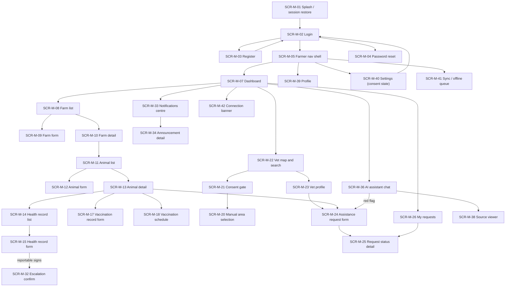
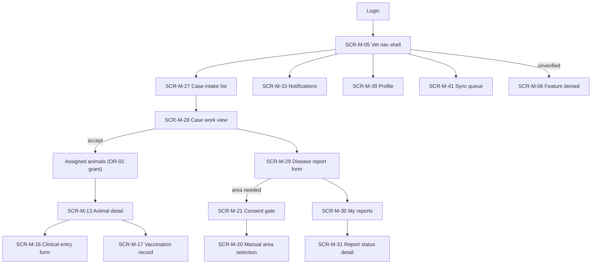
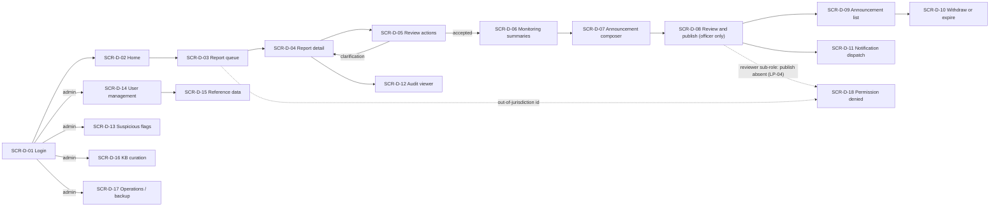

# UI Screen Inventory

| Field | Value |
|---|---|
| Project | Smart Livestock Health and Farm Management System |
| Document ID | DOC-REQ-011 |
| Title | UI Screen Inventory and Navigation Flow |
| Version | 0.1 |
| Date | 2026-11-04 |
| Author | Member B (mobile-facing requirements); dashboard pages reviewed by Member A for workflow/permission fit |
| Status | Draft for Phase 0 review |
| Parent documents | DOC-REQ-008 user stories/use cases (`US-*`, `UC-*`), DOC-REQ-002 SRS, DOC-REQ-001 charter (§4 scope, §10 TD list) |
| Companion documents | DOC-REQ-009 architecture, DOC-REQ-010 access-control matrix, DOC-REQ-012 release plan, DOC-REQ-014 test plan |
| Master-prompt step | Phase 0, Step 0.6 "UI screen inventory and wireframes; navigation flow" |

---

## 1. Purpose and reading rules

This is the complete list of screens the project intends to build, each with purpose, requirement links, required interaction states, and release. Wireframes themselves are a Phase 1 design deliverable (`docs/01_design/`); this inventory fixes **what exists and what each screen must do**, so a missing screen cannot be discovered late.

Identifiers: `SCR-M-nn` mobile (Flutter), `SCR-D-nn` dashboard (Django templates). Screen names are referenced verbatim by DOC-REQ-008 and DOC-REQ-010 — renaming a screen requires updating those documents in the same change.

**Reading rules**

1. Every screen defines four states: **loading**, **empty**, **error**, **offline** (where offline is not applicable, "n/a — online-only, with retry"). A screen that ships without these states is incomplete (NF-USE, master prompt Phase 3 task 10).
2. Role gating in this inventory is presentation only. Every action must still be enforced server-side (CON-04, ARC-1, DOC-REQ-010).
3. Requirement links (`FR-*`, `NF-*`) are provisional targets pending DOC-REQ-002 §6; they are resolved in RTM-001 (see DOC-REQ-008 §1).
4. Release column refers to DOC-REQ-012: **R1** MVP (Phases 1–3), **R2** GPS + reporting (Phase 4), **R3** authority dashboard (Phase 5), **R4** security/offline/AI (Phase 6).
5. Session-expired, permission-denied (`403/404`, AD-09) and validation-error presentations use the shared patterns in §6 and are not repeated per screen.

## 2. Mobile screens (Flutter, single role-routed codebase — AD-02)

### 2.1 Navigation shell and start-up

| ID | Screen | Purpose | Actor | Requirement links | Loading / empty / error | Offline behaviour | R |
|---|---|---|---|---|---|---|---|
| SCR-M-01 | Splash & session restore | Decide route: login vs role home; refresh token silently; show queue badge | Any | FR-AUTH-05..09, FR-OFF-10 | Spinner; n/a; "session expired — sign in again" | Reads local cache to render last known state with a stale-data banner | R1 |
| SCR-M-02 | Login | Identifier + password, role-agnostic entry, reset link, version info | Any | FR-AUTH-05..06, NF-SEC-01 | Button busy state; n/a; generic invalid-credentials message (no account disclosure), lockout message with remaining time | Cached credentials are never auto-submitted; offline shows retry/no-network | R1 |
| SCR-M-03 | Register | Farmer or veterinarian self-registration; role selector limited to those two (OR-10); area selection | Any | FR-AUTH-01..04, BR-22 | Progress; n/a; field-level validation errors from the standard envelope | Draft retained locally, submit retried | R1 |
| SCR-M-04 | Forgot / reset password | Request email token; set new password | Any | FR-AUTH-10..11, NF-SEC-04 | Progress; "no result" n/a; token expired/used message | Online-only, with retry | R1 |
| SCR-M-05 | Role home / navigation shell | Bottom nav tuned to role: Farmer (Home, Animals, Vets, Alerts, Profile) vs Veterinarian (Cases, Animals, Reports, Alerts, Profile) | F, V | FR-AUTH-12, DOC-REQ-010 | Skeleton placeholders; n/a; permission-denied route if claims mismatch | Badge counts from local queue state | R1 |
| SCR-M-06 | Feature-denied screen | Explains that the action is not available for this role/account state (for example unverified vet) | F, V | BR-22, DOC-REQ-010 | n/a | n/a; shows why + what unlocks it | R2 |

### 2.2 Farmer: farm and animal management

| ID | Screen | Purpose | Actor | Requirement links | Loading / empty / error | Offline behaviour | R |
|---|---|---|---|---|---|---|---|
| SCR-M-07 | Farmer dashboard | Herd summary (counts by species), overdue vaccinations, pending requests, unread alerts, quick actions, connectivity + queue indicator | F | FR-FARM-01..05, FR-HEALTH-07..10, FR-NOTIF-01..03, NF-USE-01 | Skeleton; "no farm yet — register your farm" onboarding empty state; stale-data banner on fetch failure | Renders from local cache with pending-sync badge | R1 |
| SCR-M-08 | Farm list | List/archive/select farms | F | FR-FARM-01..03 | Spinner; "add your first farm"; access-error state | Cached list; create queued only if FR-OFF admits it (Q3, DOC-REQ-008) | R1 |
| SCR-M-09 | Farm form (create/edit) | Name, livestock types, contact, coarse area via SCR-M-20 or consented GPS | F | FR-FARM-01..05, BR-06 | Save-in-progress; n/a; validation errors; duplicate-tag-like warnings | Draft kept on device; submit on reconnect | R1 |
| SCR-M-10 | Farm detail | Farm identity, area, animal counts, members-free (single owner), archive action, link to animals/health | F | FR-FARM-01..04, FR-HEALTH-09 | Spinner; "no animals registered yet"; denial state if identifier guessed | Cached detail with stale banner | R1 |
| SCR-M-11 | Animal list / inventory | Paginated (20) animals, search by tag/name, filter species/sex/status, sort | F | FR-ANIM-06..09, CON-09 | Progressive loading; "no animals match these filters — clear filters"; error with retry | Local list with pending rows visually marked | R1 |
| SCR-M-12 | Animal form (register/edit) | Species, breed, sex, tag, DOB **or** age estimate (estimate flag), markings, photo | F | FR-ANIM-01..05 | Save-in-progress; n/a; duplicate-tag rejection, future-date rejection | Full offline create/edit supported with queue entry | R1 |
| SCR-M-13 | Animal detail | Identity, status, timeline of health/treatment/vaccination entries, schedule preview, actions (record event, request assistance) | F, V(assigned) | FR-ANIM-01..09, FR-HEALTH-01..13 | Spinner; "no history recorded yet"; denial state for out-of-scope animals (AC-N-02) | Read from cache; new entries queued | R1 |

### 2.3 Farmer and veterinarian: health, vaccination

| ID | Screen | Purpose | Actor | Requirement links | Loading / empty / error | Offline behaviour | R |
|---|---|---|---|---|---|---|---|
| SCR-M-14 | Health record list (per animal) | Reverse-chronological history with author-role labels and pending badges | F, V | FR-HEALTH-01..09 | Spinner; "no events recorded"; error + retry | Cache + pending queue rows interleaved | R1 |
| SCR-M-15 | Health record form | Date, category, signs, severity, notes, photo (size/type limits); reportable-signs escalation prompt | F, V | FR-HEALTH-01..06, BR-23 | Save-in-progress; n/a; validation errors; oversized-photo rejection with text preserved | **Primary offline entry screen**: queue + idempotency key (UC-10) | R1 |
| SCR-M-16 | Clinical entry form (veterinarian) | Examination findings, diagnosis text, prescription/treatment, follow-up, farmer task | V | FR-HEALTH-01..06, FR-HEALTH-03, FR-HEALTH-05..06, LP-06 | Save-in-progress; n/a; assignment-expiry denial | Offline drafting queued; blocked server-side if grant lapsed | R2 |
| SCR-M-17 | Vaccination record form | Vaccine, batch/dose, route, date, administering party (vet or farmer-reported label) | F, V | FR-HEALTH-07..10, N-23 (DOC-REQ-010) | Save-in-progress; n/a; validation | Queued offline; deduplicated on replay | R1 |
| SCR-M-18 | Vaccination schedule | Pending / overdue / complete doses derived from protocol + DOB, due dates in local time (TD-14) | F | FR-HEALTH-07..10, NF-PERF-02 | Skeleton; "no schedule for this species yet — protocol not configured"; error + retry | Read from cache; recording a dose is queued | R1 |
| SCR-M-19 | Reminders view | List of generated reminders with read/dismiss state | F, V | FR-NOTIF-01..03 | Spinner; "no reminders"; error | Cached; unread count from local mirror | R1 |

### 2.4 Veterinarians, location, assistance

| ID | Screen | Purpose | Actor | Requirement links | Loading / empty / error | Offline behaviour | R |
|---|---|---|---|---|---|---|---|
| SCR-M-20 | Area selection (manual) | Choose area from server reference data, or type-ahead search; the fallback path for every location feature | F, V | FR-VET-07..09, FR-VET-02, SC-06 | List loading; "no areas match"; error + retry | **Works offline** from the cached area list (area reference data is cacheable) | R2 |
| SCR-M-21 | Location consent gate | Purpose, precision choice (coarse default / precise opt-in), retention statement, withdrawal note; shown before any permission prompt | F, V | FR-VET-01..06, BR-06, NF-PRIV-01..03 | n/a | n/a — records intent; consent state stored locally and mirrored server-side | R2 |
| SCR-M-22 | Vet map & search | OSM tiles with pins for **verified** vets, distance, list/map toggle, "self-reported location" label (AS-06) | F | FR-VET-01..09 | Map + list skeletons; "no vets in this area — try adjacent areas"; tile-failure fallback to list view; geocoder outage notice | Last result set cached for viewing; new search requires connectivity | R2 |
| SCR-M-23 | Vet profile detail | Practice area, contact route, services, verification status badge, "request assistance" action | F | FR-VET-01..06 | Spinner; n/a; denial/unavailable state | Cached view | R2 |
| SCR-M-24 | Assistance request form | Farm, animals multi-select, problem description, urgency, area (inherited from SCR-M-22/20), contact preference | F | FR-VET-05..14, FR-VET-02 | Save-in-progress; n/a; ownership-validation rejection listing the offending animal | Queued offline; single submission by idempotency key | R2 |
| SCR-M-25 | Assistance request detail & status | Timeline `PENDING → ACCEPTED → IN_PROGRESS → COMPLETED`, or `DECLINED`/`CANCELLED`, assigned vet, notes, cancel-with-reason, confirm-completion | F | FR-VET-05..14 | Spinner; n/a; conflict state if already assigned; denial for non-owner | Cached timeline; cancellation queued | R2 |
| SCR-M-26 | My requests list | Farmer's requests grouped by open/closed with status chips | F | FR-VET-05..14 | Skeleton; "no requests yet"; error | Cache + pending badge | R2 |
| SCR-M-27 | Case intake list (veterinarian) | Eligible `PENDING` requests for my service areas (pre-accept view: species, urgency, coarse area only — N-27) | V | FR-VET-05..14, OR-02 | Skeleton; "no open cases"; error | Cache only; accept requires connectivity | R2 |
| SCR-M-28 | Case work view (veterinarian) | Request detail, accepted-animal list, jump to clinical entry, status transitions, close | V | FR-VET-05..14, BR-02 | Spinner; n/a; already-assigned conflict; expiry-denied state | Notes drafted offline; status writes queued and revalidated | R2 |

### 2.5 Reporting, announcements, notifications

| ID | Screen | Purpose | Actor | Requirement links | Loading / empty / error | Offline behaviour | R |
|---|---|---|---|---|---|---|---|
| SCR-M-29 | Disease report form (veterinarian) | Species, animal details, observation date, area (mandatory), observed signs, suspect condition, notes, optional evidence; visible "suspected / unverified" banner | V | FR-REPORT-04..10, BR-23, BR-22 | Save-in-progress; n/a; missing-area block, unverified-vet refusal, evidence size/type error | Draft offline; queued submission replayed once | R2 |
| SCR-M-30 | My reports list & status | Own reports with review status chips and clarification indicators | V | FR-REPORT-07, FR-REPORT-10..12 | Skeleton; "no reports submitted"; error | Cache; clarification answers queued | R2/R3 |
| SCR-M-31 | Report status detail | Field-by-field report, status history, reviewer questions/answers, amendment visibility | V | FR-REPORT-07, FR-REPORT-10..12, BR-18 | Spinner; n/a; denial if not author | Cache | R3 |
| SCR-M-32 | Farmer escalation confirmation | Confirms escalating an observation to veterinary disease assessment; states that no official alert is created (BR-23) | F | FR-REPORT-01..03, FR-VET-05..14 | n/a | Queued with the observation | R2 |
| SCR-M-33 | Notifications centre (inbox) | Reminders, case updates, report updates, official announcements; unread badge; read/dismiss | F, V | FR-NOTIF-01..07 | Spinner; "nothing new"; fetch error | Cached inbox; new items arrive on next pull (EXCL-09) | R1 (reminders) / R3 (announcements) |
| SCR-M-34 | Announcement detail (official) | Issuing authority, affected area, publication date, review/expiry date, prevention guidance, `OFFICIAL` label, version/withdrawal status | F, V | FR-ANN-01..12, OR-05, BR-23 | Spinner; "no current advisories for your area"; denial for non-published | Cached read of previously fetched published notices, each labelled with its publication date | R3 |
| SCR-M-35 | Announcement list (area) | Current official advisories for the user's area set, with `EXPIRED`/`WITHDRAWN` visibly separated | F, V | FR-ANN-11..12, BR-23 | Skeleton; empty; error | Cache | R3 |

### 2.6 Assistant

| ID | Screen | Purpose | Actor | Requirement links | Loading / empty / error | Offline behaviour | R |
|---|---|---|---|---|---|---|---|
| SCR-M-36 | AI assistant chat | Question entry, answer bubbles with mandatory "general information, not a diagnosis" label, citation list, source/version metadata, provider-mode note | F, V | FR-AI-01..07, BR-25, POL-AI-04 | Typing indicator; "ask your first question"; provider-unavailable fallback notice (KB-only or static fallback), refusal answer rendering | **Online-only** except a locally cached FAQ subset; explicit "assistant unavailable offline" message | R4 |
| SCR-M-37 | Assistant refusal / red-flag card | Refusal for diagnosis/dosage requests with a "request veterinary assistance" action | F, V | FR-AI-01..07, FR-VET-05..14 | n/a | n/a; the action itself is queued if offline | R4 |
| SCR-M-38 | Source/reference viewer | Shows the cited KB entry: title, source, review date, version | F, V | FR-AI-01..07 | Spinner; n/a; unavailable-source note | Cached sources readable offline | R4 |

### 2.7 Account, settings, sync

| ID | Screen | Purpose | Actor | Requirement links | Loading / empty / error | Offline behaviour | R |
|---|---|---|---|---|---|---|---|
| SCR-M-39 | Profile | Name, contact, area, role and verification status (read-only for status), password change, email change | F, V | FR-AUTH-12..13 | Save-in-progress; n/a; validation | Draft offline; write queued only for permitted fields | R1 |
| SCR-M-40 | Settings | Theme/text scale, notification preferences, **location-permission state** (granted / denied / not determined + what it enables), cache size, data-retention summary, sign out | F, V | FR-VET-01..06, NF-PRIV-01..04, NF-USE-03 | n/a | Editable offline; syncs preferences when possible | R1 (basic) / R2 (consent state) / R4 (retention summary) |
| SCR-M-41 | Sync / offline queue | Per-item list: pending / failed (with reason) / conflict-resolved (both values) / synced; counts; manual retry; "sync now" | F, V | FR-OFF-09..11, BR-20, SC-04 | Progress during drain; "everything synced"; item-level error with retry | This screen **exists because** the device is offline; states defined for each bucket | R4 |
| SCR-M-42 | Connection status banner (global) | Non-blocking indicator: online / offline / server unreachable, plus queue badge | F, V | FR-OFF-10, NF-USE-02 | n/a | Detects and displays offline; recovers automatically | R4 |
| SCR-M-43 | About / help / privacy | Plain-language how-to, privacy and GPS policy summary (DOC-REQ-006), assistant limitations, contact route, app/build version, E2E demo entry | F, V | NF-PRIV-01..04, BR-25, NF-USE-04 | n/a | Read from bundled asset, always available offline | R1 (stub) / R4 (full text) |
| SCR-M-44 | Legal/consent acknowledgement gate | One-time acknowledgement of privacy/GPS terms before first location use or registration | F, V | NF-PRIV-01, BR-06 | n/a | Recorded locally, mirrored server-side | R2 |

## 3. Dashboard screens (Django templates — Authority + Administrator)

Session-authenticated, CSRF-protected (TD-13), jurisdiction-scoped (OR-03). No dashboard page is reachable by Farmer or Veterinarian roles (AC-N-14).

| ID | Page | Purpose | Actor | Requirement links | States (loading / empty / error) | R |
|---|---|---|---|---|---|---|
| SCR-D-01 | Dashboard login | Staff sign-in with lockout messaging, session timeout notice | Authority, Admin | FR-AUTH-05..09, NF-SEC-01..03, TD-07 | Button state; n/a; invalid-credentials generic message, lockout remaining time | R3 |
| SCR-D-02 | Authority home | Counts by status in my jurisdiction, overdue reviews, current advisories, recent flags | Authority (both sub-roles) | FR-REPORT-03..05, FR-ANN-01..10 | Spinner; "no reports in your jurisdiction"; partial-failure notice | R3 |
| SCR-D-03 | Report review queue | Filterable/sortable list of reports: status, area, species, received date, SLA age; pagination | Authority | FR-REPORT-03..05, CON-09 | Table skeleton; "no reports match the filter"; error with retry | R3 |
| SCR-D-04 | Report review detail | Full report fields, author, area, evidence, status history, **persistent `UNVERIFIED REPORT` banner**, limited linked case context (OR-11) | Authority | FR-REPORT-03..05, FR-REPORT-07, FR-REPORT-10, FR-ANN-04, BR-23, BR-08, Q-C/DOC-REQ-008 | Detail load; "no supporting records attached"; denial for out-of-jurisdiction (AD-09 404) | R3 |
| SCR-D-05 | Review action panel | Set `UNDER_REVIEW`, request clarification (question text), decide `ACCEPTED_FOR_ASSESSMENT` or `REJECTED` (reason mandatory), `CLOSED`; illegal transitions disabled **and** server-refused | Authority | FR-REPORT-03..05, FR-REPORT-07, FR-REPORT-10, FR-ANN-04, BR-18 | Save state; n/a; validation error, concurrent-edit warning | R3 |
| SCR-D-06 | Monitoring summaries | Reports per area/species/time window as **signals for investigation**, explicitly not confirmation; no publish control on this page | Authority | FR-REPORT-09, EXCL-01, EXCL-13, BR-23 | Chart/table loading; "insufficient data for this window"; error | R3 |
| SCR-D-07 | Announcement composer | Draft with issuing authority, affected area(s), publication date, review/expiry date, prevention guidance, target audience; autosave drafts (Authority-role visible only, OR-05) | Authority officer (reviewer may draft, cannot publish) | FR-ANN-01..06, BR-24 | Save state; "no drafts"; validation errors on publish | R3 |
| SCR-D-08 | Announcement review & publish | review decision recorded, then a human **Publish** action by an officer who is *not* the draft author (FR-ANN-03, BR-24), with confirmation and mandatory reason; publish control absent for the reviewer sub-role (LP-04) | Authority | FR-ANN-07..08, BR-24, LP-07 | Save state; n/a; denial attempt shows 403 page and is audited (AC-N-06) | R3 |
| SCR-D-09 | Announcement management list | Published/updated/expired/withdrawn announcements in jurisdiction with version count and next review date | Authority | FR-ANN-09..12 | Table loading; "no active advisories"; error | R3 |
| SCR-D-10 | Withdraw / expire action | Withdraw with mandatory reason; set/adjust review-expiry date; system expiry noted as `SYSTEM` event | Authority officer | FR-ANN-09..10, BR-24, N-40 (DOC-REQ-010) | Save state; n/a; state-conflict error | R3 |
| SCR-D-11 | Notification dispatch summary | Recipient count per area set, delivery-insert failures, retry outcome (targets computed by OR-07, not typed) | Authority | FR-NOTIF-04..07 | Loading; "no recipients matched"; failure list | R3 |
| SCR-D-12 | Audit log viewer | Read-only, filterable audit rows: actor, action, target, timestamp, change summary; no edit/delete control anywhere; jurisdiction-limited | Authority, Admin (admin scope per N-43) | NF-SEC-05, POL-AUDIT-01..07, OR-06, LP-09 | Table loading; "no events for these filters"; error; note when result set truncated | R3 |
| SCR-D-13 | Suspicious activity flags | Flag list (login failures, sensitive-edit bursts), rule name and threshold shown, dismiss-with-reason action; wording = signal, never finding (`D-11`) | Admin, Authority | NF-SEC-05..06, TD-07 | Loading; "no open flags"; error | R4 |
| SCR-D-14 | User management | List users: identity, role, sub-role, jurisdiction, verification, account status; create staff accounts; verify vets; deactivate/restore; role/sub-role/jurisdiction edits (LP-02 — no clinical columns shown) | Admin | FR-AUTH-13..16, US-ADMIN-01/02/03, BR-05 | Table loading; "no pending verifications"; error | R3 |
| SCR-D-15 | Reference data management | Areas and vaccination protocols (doses, intervals, species); edits audited; no retroactive rewrite of completed records | Admin | FR-FARM-06..07, FR-HEALTH-07..10, N-45 | Form/table states as above | R3 (R1 minimal seeding via fixtures) |
| SCR-D-16 | Knowledge-base curation | KB entry create/edit/archive with source citation and review date; versioning (AD-08) | Admin | FR-AI-01..07, TD-10 | Table/form states as above | R4 |
| SCR-D-17 | Operations / maintenance view | Backup and retention status, last restore drill, failed-notification and sync-failure aggregates | Admin | NF-REL-01..03, NF-REL-05 | Loading; "no jobs recorded"; error | R4 |
| SCR-D-18 | Permission-denied page | Shown for any unauthorised dashboard URL, proving hiding is not the control | Any staff | DOC-REQ-010, AC-N-14 | n/a | R3 |

## 4. Screen inventory summary

| Group | Count | Release coverage |
|---|---|---|
| Mobile start/auth/shell | 6 (SCR-M-01..06) | R1, plus SCR-M-06 in R2 |
| Mobile farm/animal/health/vaccination | 13 (SCR-M-07..19) | R1 core, SCR-M-16 in R2 |
| Mobile vets/assistance/location | 9 (SCR-M-20..28) | R2 |
| Mobile reporting/announcements/notifications | 7 (SCR-M-29..35) | R2/R3 |
| Mobile assistant | 3 (SCR-M-36..38) | R4 |
| Mobile account/settings/sync | 6 (SCR-M-39..44) | R1/R2/R4 |
| **Mobile total** | **44** | — |
| Dashboard pages | 18 (SCR-D-01..18) | R3 core, SCR-D-13/16/17 in R4 |
| **All surfaces** | **62** | — |

MVP (R1) surface count: 15 mobile screens (SCR-M-01..15 subset, 17..20 excluded — precisely: 01–15, 17–19, 33, 39, 43-stub = 21 mobile screens, no dashboard). Reconciled against DOC-REQ-012 §4.

## 5. Navigation flows

### 5.1 Farmer mobile

### 5.2 Veterinarian mobile

### 5.3 Authority / administrator dashboard

## 6. Shared interaction patterns (normative for every screen)

| ID | Pattern | Requirement |
|---|---|---|
| ST-01 | **Loading**: skeleton or spinner; action buttons disabled while in flight; no duplicate submission on double tap (SC-04 client-side complement) | NF-USE-01 |
| ST-02 | **Empty**: distinct copy for "none yet" (first-run guidance) vs "no matches" (filter reset action) vs "none available" (service has no data, e.g. no vets in area) | NF-USE-02 |
| ST-03 | **Error**: standard error envelope rendered field-by-field on forms, with retry where transient; never a stack trace or raw server message | NF-USE-03, TD-05 |
| ST-04 | **Offline**: cached content shown with a stale banner; writable screens queue to `PENDING_SYNC`; read-only screens state plainly what is unavailable offline | NF-PRIV-02, BR-20 |
| ST-05 | **Permission denied**: purpose-neutral message "you do not have access to this record" plus the action that would grant it (e.g. accept the case); no field echo of the hidden object | DOC-REQ-010 OR-12 |
| ST-06 | **Session expired**: route to login preserving the in-progress form draft locally; return to the original screen after re-auth | NF-SEC-01 |
| ST-07 | **Conflict surfaced**: `CONFLICT_RESOLVED` items show both values with the re-apply action; never silently overwritten | TD-09, SC-04 |
| ST-08 | **Official vs unverified labelling**: `OFFICIAL`, `UNVERIFIED REPORT`, `WITHDRAWN`, `EXPIRED` use distinct, consistent label tokens and colour semantics everywhere | BR-23, FR-ANN-11..12 |
| ST-09 | **Assistant labelling**: every answer carries the "general information, not a diagnosis" chip, citation affordance, and provider-mode/fallback metadata | BR-25, SC-05 |
| ST-10 | **Consent transparency**: a persistent icon/summary shows whether location consent is active; withdrawal returns the app to manual area mode immediately | BR-06, NF-PRIV-01..04 |
| ST-11 | **Queue badge**: a single count (pending + failed + conflict) available from every tab in R4 | FR-OFF-09..11 |
| ST-12 | **Sync-then-wipe on logout**: logout warns and offers sync-then-logout; cached business data is wiped, and on forced logout only the encrypted pending queue is retained under the account key until the next sign-in or an explicit discard (FR-OFF-07/08, BR-14) | FR-OFF-07/08, NF-PRIV-02 |
| ST-13 | **Accessibility & text**: minimum touch target 48 dp, icon-plus-label navigation, adjustable text scale, no information conveyed by colour alone (status labels always carry text) | NF-USE-04, AS-02 |
| ST-14 | **Long lists**: paginate at 20, infinite scroll or explicit "load more", plus the empty/error states on continuation failure | CON-09 |

## 7. Wireframe and design follow-up (Phase 1)

1. Low-fidelity wireframes for the R1 screens first (21 mobile screens), then R2–R4, stored in `docs/01_design/wireframes/`; each wireframe header carries its `SCR-*` ID so this inventory stays the index.
2. A component inventory (app bar, status chip set, form field with error slot, offline banner, sync badge, empty-state template, citation card) is derived from §6 patterns so that states are implemented once.
3. Visual separation tokens for ST-08 (`OFFICIAL` / `UNVERIFIED` / `WITHDRAWN` / `EXPIRED`) are fixed here in words and must be implemented identically on mobile and dashboard.

## 8. Open points for Phase 0 review

| ID | Point | Assumption used here |
|---|---|---|
| U-1 | Do farmers get a per-animal weight/production tracking screen beyond health events? | Not in R1–R4; general observation only |
| U-2 | Is SCR-M-06 (feature denied) a screen or an inline state? | Inline card plus a route, so AC-N-14 has an observable result |
| U-3 | Can a veterinarian attach an animal to an existing request after acceptance? | No; new request required (protects OR-02 grant scope) |
| U-4 | Is the KB-subset cached for the assistant offline (SCR-M-36)? | Small FAQ subset cached; full assistant online-only |
| U-5 | Does the dashboard need a printable announcement/PDF export for the partner authority? | Not planned; documented as future work (would add a library) |
| U-6 | Single-farm farmers: is SCR-M-08 collapsed into SCR-M-10? | Kept separate; one-farm users see a shortcut on the dashboard |
