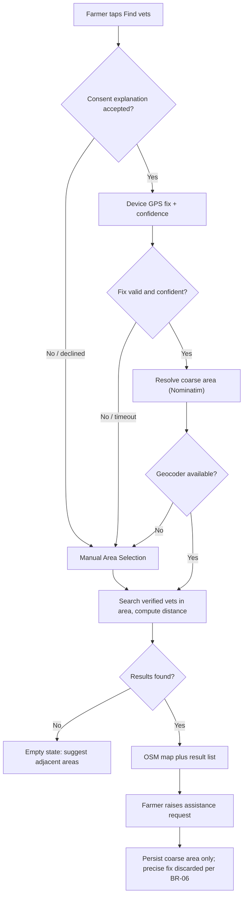
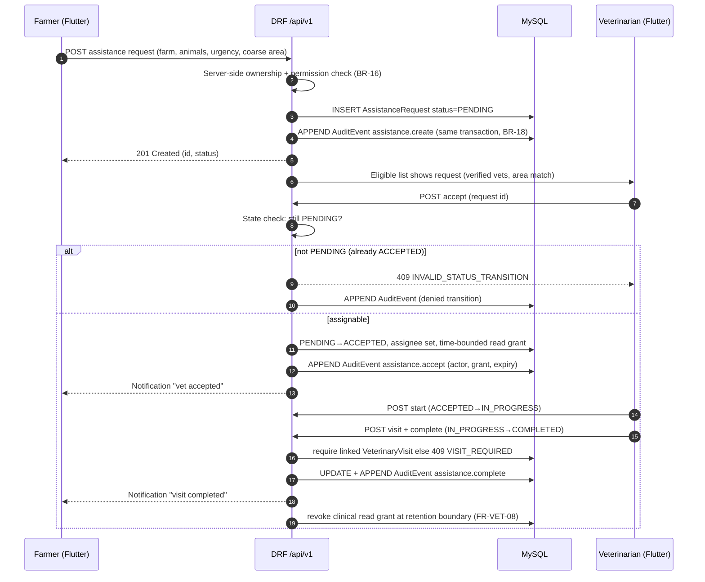
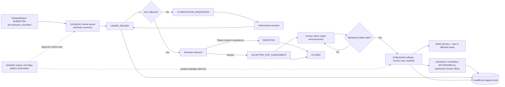
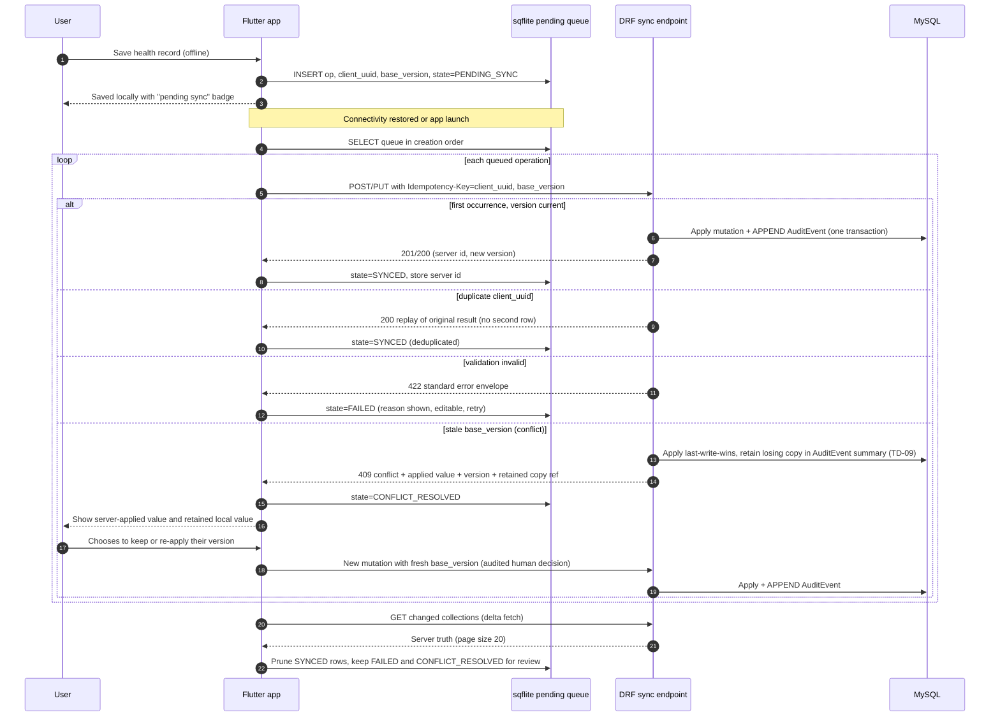

# User Stories and Use Cases

| Field | Value |
|---|---|
| Project | Smart Livestock Health and Farm Management System |
| Document ID | DOC-REQ-008 |
| Title | User Stories, Use Cases and Workflow Acceptance Criteria |
| Version | 0.1 |
| Date | 2026-11-04 |
| Author | Member B (mobile-facing requirements); reviewed by Member A for backend/permission behaviour |
| Status | Draft for Phase 0 review |
| Parent documents | DOC-REQ-001 `project-charter.md`, DOC-REQ-002 `software-requirements-specification.md` |
| Companion documents | DOC-REQ-003 business rules, DOC-REQ-010 access-control matrix, DOC-REQ-011 UI screen inventory, RTM-001 traceability matrix |
| Master-prompt step | Phase 0, Step 0.5 "Document the workflows" |

---

## 1. Purpose and scope

This document states what each role must be able to accomplish, in testable form:

1. User stories per role, identified `US-<ROLE>-<NN>`, with Given/When/Then acceptance criteria.
2. Use cases `UC-01`..`UC-12` for the principal workflows, with preconditions, main flow, alternate/exception flows and postconditions.
3. Mermaid diagrams for the three workflows with the highest design risk: assistance request, disease report to official announcement, offline sync with conflict.
4. The workflow constraints the flows depend on (§3).

**What this document deliberately does not contain.** Requirement text and requirement numbering belong to DOC-REQ-002, and business-rule numbering belongs to DOC-REQ-003 (`BR-01`..`BR-38`). Links below point at those IDs. Where a link points at a requirement that turns out not to exist, either the requirement is added to DOC-REQ-002 or the story is withdrawn; that orphan check is performed in RTM-001 before Phase 1 starts (DOC-REQ-015 §5 item C-7, §6 rule NF-MNT-08).

Authoritative terminology used below is defined in DOC-REQ-002 §4 (`D-01`..`D-20`), notably: disease report = veterinarian-authored, unverified by definition (`D-08`); outbreak announcement = official, authority-published (`D-09`); idempotency key (`D-12`); coarse location (`D-15`) vs precise location (`D-16`); jurisdiction (`D-14`).

Screen names (for example *Vet Map & Search*, *Sync / Offline Queue*) are normative in DOC-REQ-011. Permission outcomes ("denied server-side") are normative in DOC-REQ-010.

## 2. Actors and story ID tokens

| Token | Actor | Account origin | Mobile app | Authority dashboard |
|---|---|---|---|---|
| `FARMER` | Farmer / livestock owner | Self-registration | Yes (primary) | No |
| `VET` | Veterinarian | Self-registration, then administrator verification (`D-17`) | Yes | No |
| `AUTHORITY` | Veterinary authority: **reviewer** sub-role (assess, cannot publish) and **officer** sub-role (publish/withdraw/expire) | Provisioned by System Administrator only | No | Yes (primary) |
| `ADMIN` | System Administrator | Provisioned per institutional policy | No | Yes (administration pages, Django admin) |
| `SYSTEM` | Backend services: scheduler, audit writer, notification generator, sync processor, rule engine | n/a | n/a | n/a |
| `ASSISTANT` | AI information assistant, a bounded read-only software actor (DOC-REQ-002 §5) | n/a | Chat surface only | No |

One `User` holds exactly one role (AS-04, ARC-2). Stories use the format *As an \<actor\>, I want \<capability\>, so that \<value\>*; acceptance criteria are Given/When/Then; priority is MoSCoW as defined in DOC-REQ-002 §2.2; the Release column refers to DOC-REQ-012 releases R1..R4.

## 3. Workflow constraints asserted by this document

Business-rule numbering is owned by DOC-REQ-003 (`BR-01`..`BR-38`); requirement numbering is owned by DOC-REQ-002. The rows below restate, in workflow language, rules that already exist there — they do not create new rules. Every row cites its authoritative ID, so a story that depends on a constraint can be traced straight to DOC-REQ-003.

| Constraint as the flows rely on it | Authoritative rule |
|---|---|
| A submitted or accepted disease report is a suspected professional claim; nothing in the system may render, serialise, aggregate or notify it as a confirmed outbreak, and a report may only be *linked* to an announcement, never converted into one. | `BR-23`, `BR-28` |
| Only an authenticated human `AUTHORITY` **officer** may publish, revise a published announcement, withdraw or expire it; no rule, count, pattern view, scheduled job or assistant output may do so, and the publisher must not be the draft author. | `BR-04`, `BR-24`, FR-ANN-03 |
| The assistant is general information only: mandatory disclaimer, citations or an explicit no-answer state, no diagnosis of a named animal, no dosage/prescribing, no write operations, no alert publication. | `BR-25`, `BR-26`, `BR-24` |
| Location capture is consent-based and purpose-bound; the persisted default is a coarse area (`D-15`), precise coordinates (`D-16`) exist only where a requirement permits them with a live consent record and are released only to the counterparty of an accepted assistance request; precise coordinates never appear in logs or audit summaries. | `BR-06`, `BR-12` |
| Wherever location is needed, a manual area-selection path must work with permission denied, GPS unavailable, or a low-confidence fix. | `BR-06` (coarse-only default), FR-VET-01/11, SC-06, DEP-2 |
| Authorisation is enforced on the server for every request; the API surface is deny-by-default and client-side gating is cosmetic. | `BR-16`, `BR-13` |
| A veterinarian may read or write clinical data only through an assigned assistance request, a recorded visit, or an explicit farmer grant; that access expires when the request is cancelled. | `BR-02`, `BR-02a`, FR-FARM-08 |
| Acceptance of an assistance request grants time-bounded read access to the animals named in that request only. | `BR-02` |
| Farmers touch only their own farms and animals; another farmer's object is answered with 404, never 403. | `BR-01` |
| `ADMIN` performs account and configuration work with no default clinical read access; Django admin is not a clinical data browser; break-glass requires a second approval and self-audits. | `BR-05` |
| Authority visibility of reports, patterns and audit rows is bounded by jurisdiction (`D-14`); vets see only their own reports. | `BR-08`, `BR-34` |
| Farmers never receive other farmers' records, aggregate report counts or reporter identities, including through notifications; drafts and review notes stay inside `AUTHORITY`. | `BR-09`, `BR-10`, `BR-36` |
| Status changes follow the DOC-REQ-002 §8 transition tables exactly; every other transition is rejected with 409 and changes nothing. | `BR-07` |
| Every review decision records actor, timestamp, previous and new status and a reason; a decision without a reason is rejected. | `BR-31` |
| Records are soft-deleted/archived by default; hard deletion occurs only through an authorised retention procedure and is audited. | `BR-33` (retention anonymisation), charter §4.3-4, EXCL-10 |
| Every sensitive mutation writes its `AuditEvent` (`D-10`) in the same transaction; audit rows are append-only and no role may update or delete them. | `BR-18`, `BR-33` |
| Offline mutations are queued with a client-generated UUID idempotency key (`D-12`); a replayed key returns the original outcome and creates nothing second; concurrent conflicts resolve last-write-wins-with-audit with the rejected version kept verbatim. | `BR-20`, `BR-19` |
| The device holds an encrypted allow-listed subset only and is wiped on logout; queued mutations survive only under the same account key until synced or explicitly discarded. | `BR-14` |
| A veterinarian must be verified (`D-17`) before authoring a disease report or any clinical entry; unverified vets have directory-read only. | `BR-22`, `BR-03` |
| Self-registration yields Farmer or Veterinarian only; authority and administrator accounts are provisioned. | `BR-21`, `BR-17` |
| Authentication is rate-limited and lockout-bearing (BR-11) and tokens are short-lived and blacklisted on logout. | `BR-11`, `BR-15` |
| Assistance requests, assistant questions and sync batches are rate- and size-limited; attachments are validated, re-encoded and EXIF-stripped. | `BR-29`, `BR-30` |
| Expired or withdrawn announcements stay readable with an explicit status label; expiry is a system job with `actor = system`. | `BR-35` |
| Development, demonstration and testing data is synthetic. | `BR-38` |

## 4. Farmer user stories

| ID | Story | P | Requirement links (provisional) | Release |
|---|---|---|---|---|
| US-FARMER-01 | Register an account with farmer role, area and contact details. | M | FR-AUTH-01..04 | R1 |
| US-FARMER-02 | Sign in, sign out safely, and have expired sessions handled. | M | FR-AUTH-05..09, NF-SEC-01..03 | R1 |
| US-FARMER-03 | Reset my password by email. | M | FR-AUTH-10..11, NF-SEC-04 | R1 |
| US-FARMER-04 | Register and manage my farm(s). | M | FR-FARM-01..05 | R1 |
| US-FARMER-05 | Register an animal with species, breed, sex, DOB or age estimate and tag. | M | FR-ANIM-01..05 | R1 |
| US-FARMER-06 | Search, filter and view my animal inventory. | M | FR-ANIM-06..09 | R1 |
| US-FARMER-07 | Record a health event for an animal. | M | FR-HEALTH-01..06 | R1 |
| US-FARMER-08 | View the health, treatment and vaccination history of an animal. | M | FR-HEALTH-07..09 | R1 |
| US-FARMER-09 | Keep a vaccination schedule and receive reminders for due doses. | M | FR-HEALTH-07..10, FR-NOTIF-01..03 | R1 |
| US-FARMER-10 | Find nearby verified veterinarians on a map after granting consent. | S | FR-VET-01..06 | R2 |
| US-FARMER-11 | Search veterinarians by manually selected area when GPS is unavailable or declined. | M | FR-VET-07..09 | R2 |
| US-FARMER-12 | Raise a veterinary assistance request and follow its status. | M | FR-VET-05..14 | R2 |
| US-FARMER-13 | Escalate an observation with reportable signs for veterinary disease assessment. | S | FR-REPORT-01..03, FR-VET-05..14 | R2 |
| US-FARMER-14 | Record animals and health entries offline and have them sync safely. | M | FR-OFF-01..09, NF-PRIV-02 | R4 |
| US-FARMER-15 | Ask the assistant general livestock-health questions and see its sources. | C | FR-AI-01..07, POL-AI-04 | R4 |
| US-FARMER-16 | Receive official announcements and reminders relevant to my area in my notification centre. | M | FR-ANN-01 read, FR-NOTIF-04..07 | R1 (reminders) / R3 (announcements) |
| US-FARMER-17 | Edit my profile, change my password, and control my location-consent state. | M | FR-AUTH-12..13, FR-VET-01..06, NF-PRIV-01..03 | R1 (profile) / R2 (consent toggle) |
| US-FARMER-18 | See the sync state of my queued entries and the reason for any failure. | M | FR-OFF-09..11, NF-USE-02 | R4 |

### Acceptance criteria — farmer

**US-FARMER-01 Register**
- Given a new user on *Register*, when a valid email, policy-strength password, name, phone and area are submitted with role fixed to Farmer, then the account is created, the password is stored with Argon2 hashing (TD-02), and the user can sign in.
- Given a duplicate email or a weak password, when submitted, then the API returns the standard error envelope (TD-05) with field-level details and no partial account exists.
- Given the registration form, then no control exists to select the Authority or Administrator role (self-promotion is impossible; see DOC-REQ-010 OR-10).

**US-FARMER-02 Sign in / session**
- Given valid credentials, when signing in, then an access token and a refresh token are returned (TD-01) and the app stores them in device secure storage.
- Given an expired access token, when the app calls any endpoint, then a silent refresh is attempted once; on refresh failure the user lands on *Login* with "session expired" and any in-progress form draft is preserved.
- Given logout, when confirmed, then the refresh token is blacklisted, the local SQLite copy is wiped (BR-14), and a subsequent deep link into *Animal Detail* requires re-authentication.
- Given repeated failed logins crossing the configured `django-axes` threshold (TD-07), when the next attempt arrives, then login is locked for the configured lockout duration and each failure is an `AuditEvent`.

**US-FARMER-03 Password reset**
- Given a registered email, when reset is requested, then a tokenised reset link is emailed and the reset page accepts a new policy-strength password, invalidating earlier tokens.
- Given an unknown email, when requested, then the response is identical to the success case so that account existence is not disclosed (NF-SEC-04).

**US-FARMER-04 Farm management**
- Given an authenticated farmer with no farm, when *Farm Form* is completed with name, livestock types and area, then the farm is persisted with owner = farmer and appears in *Farm List*.
- Given a farm identifier belonging to another farmer, when the farmer requests it, then the server denies access and no field of that farm is disclosed (BR-16, DOC-REQ-010 OR-01).
- Given a farm with live animals, when the farmer archives it, then it is flagged archived, retained for history (FR-HEALTH-09), and disappears from active lists.

**US-FARMER-05 Register animal**
- Given a farm the farmer owns, when *Animal Form* is submitted with species, sex, tag and either DOB or an age estimate, then the animal is saved, counted in the inventory, and its vaccination schedule is generated where a protocol exists.
- Given a duplicate tag within the same farm, when submitted, then validation rejects it and nothing is saved.
- Given only an estimated age, then the estimate flag is stored and displayed in reports so that derived due dates are marked approximate.

**US-FARMER-06 Inventory search and filter**
- Given at least 21 animals, when the list loads, then results are paginated at page size 20 (CON-09) and the total count matches the database.
- Given filters species = cattle and a partial tag search, then only matching animals of the farmer's farms are returned.
- Given no matches, then the empty state renders, not an error state.

**US-FARMER-07 Record a health event**
- Given an owned animal, when the farmer saves date, category, signs, severity and notes, then a `HealthRecord` (D-04) is created with author and author role recorded, and appears in *Health Record List* newest first.
- Given a future event date, then the server rejects it with a field error.
- Given a photo above the configured size/type limits, then the upload is rejected with a stated reason and the text record is not lost.
- Given signs marked reportable, then the app offers the escalation path (US-FARMER-13) and does not create any report or announcement itself (BR-23).

**US-FARMER-08 View history**
- Given animal history containing farmer observations and veterinarian clinical entries, when opened, then all permitted entries render in reverse chronological order with author role labelled; veterinarian-authored clinical content is read-only to the farmer.
- Given a veterinarian correction to an earlier entry, then the corrected value and its audit change summary (`D-13`) are both visible; silent overwrite is not permitted (BR-18).

**US-FARMER-09 Vaccination schedule and reminders**
- Given an animal with species and DOB, when the protocol exists, then dose due dates are derived and listed in *Vaccination Schedule* as pending/overdue/complete.
- Given a dose due inside the reminder window, when the reminder job runs, then exactly one `Notification` exists for that dose per day, and a completed dose generates none.
- Given a dose recorded as administered, then the schedule item becomes complete and reminder generation stops for it.

**US-FARMER-10 Nearby veterinarians with consent**
- Given no prior consent, when "Find vets near me" is tapped, then a purpose-and-retention explanation is shown first and no permission prompt or geocoding call occurs until the farmer accepts (BR-06).
- Given consent granted and a confident fix, then verified veterinarians for the resolved area are shown with distance and contact details, and the value persisted with any resulting request is the coarse area (`D-15`) unless the farmer explicitly opts into precise disclosure.
- Given Android 12+ approximate-location chosen, then search still works on the coarse value.

**US-FARMER-11 Manual area fallback**
- Given consent denied, GPS timeout, or a low-confidence fix, when the farmer reaches *Area Selection* and chooses an area from server reference data, then the veterinarian list returns for that area and every downstream action (request, report escalation) is available exactly as in the GPS path (FR-VET-02, SC-06).
- Given a GPS-derived area that the farmer recognises as wrong, when the manual area is selected, then the manual area is what is stored and used for the request.

**US-FARMER-12 Assistance request**
- Given farm, animals, problem description, urgency and a resolved area, when submitted, then an `AssistanceRequest` (D-07) is created in status `PENDING`, visible in *Assistance Request Detail* with its status timeline.
- Given the request lists an animal the farmer does not own, when posted, then the server rejects it and no partial request exists.
- Given status `ACCEPTED` or `IN_PROGRESS`, then structural edits (animals, urgency) are blocked client- and server-side; cancellation with reason remains available.
- Given another farmer's request identifier, when requested by the owning farmer's session, then access is denied server-side.

**US-FARMER-13 Escalation for disease assessment**
- Given a farmer observation flagged reportable, when the farmer escalates, then the observation is attached to an assistance request and marked for veterinarian review; no `DiseaseReport` (`D-08`) row is created by the farmer (BR-23, charter §4.3-1).
- Given the escalation, then the mobile surface labels it "unverified farmer observation" and never uses official wording or outbreak framing.

**US-FARMER-14 Offline entry and sync**
- Given no connectivity, when the farmer saves a permitted entry, then it is stored locally with a client UUID (TD-09), shown with a `PENDING SYNC` badge and counted in *Sync / Offline Queue*.
- Given connectivity returns, then queued operations are replayed in order, each carrying its idempotency key; replays of one key produce exactly one server mutation (SC-04).
- Given an operation rejected by server validation, then it moves to `FAILED`, the standard error envelope reason is shown, and the entry stays editable for corrected retry.
- Given a queued edit whose server version has changed, then the configured conflict rule applies (TD-09: last-write-wins with the losing copy preserved and audit-logged), the app surfaces the item as `CONFLICT RESOLVED — server applied newer value` with the retained copy reachable, and the farmer can re-apply their value as a new audited edit. Silent loss of either version is a defect.

**US-FARMER-15 Assistant question**
- Given a husbandry question, when answered, then the reply carries the "general information, not a diagnosis" label, at least one cited reviewed source, and — where red flags appear — an explicit "contact a veterinarian" action that opens *Assistance Request Form*.
- Given a request for a drug or dosage, then the assistant refuses the instruction, explains why, and offers the veterinary-contact path (BR-25, EXCL-02).
- Given `ASSISTANT_LLM_ENABLED = false` or provider failure, then the KB-only provider answers from the curated base, or a static fallback with contact guidance is returned; no unsupported invented content appears (TD-10, DEP-4).
- Given any assistant answer, then no create/update/delete API call is observable in server logs for that session path (SC-05).

**US-FARMER-16 Announcements and reminders**
- Given an announcement published for the farmer's area, when *Notifications* renders, then it shows issuing authority, affected area, publication date, review/expiry date and prevention guidance, visibly labelled `OFFICIAL`.
- Given a withdrawn or expired announcement, then it is labelled `WITHDRAWN`/`EXPIRED` and never presented among current guidance.
- Given a report in the same area that is still unverified, then no mobile surface presents its count or status as confirmation of an outbreak (BR-23).

**US-FARMER-17 Profile and consent control**
- Given the farmer changes phone or area, then the change persists; changes to email, password and consent state are audit-logged.
- Given location consent switched off in *Settings*, then the vet-search flow goes directly to *Area Selection* and no permission request occurs.
- Given the farmer withdraws consent, then previously persisted coarse areas are retained only as required for the records already created, and this is stated in the privacy policy (DOC-REQ-006).

**US-FARMER-18 Sync transparency**
- Given a queue with 3 pending, 1 failed and 1 conflict-resolved item, then *Sync / Offline Queue* shows per-item status, reason, timestamp and a manual retry action, and the badge count equals the pending total.

## 5. Veterinarian user stories

| ID | Story | P | Requirement links (provisional) | Release |
|---|---|---|---|---|
| US-VET-01 | Register as a veterinarian and submit credentials for administrator verification. | M | FR-AUTH-01..04, FR-AUTH-14, FR-VET-01..04, BR-22 | R1 |
| US-VET-02 | Maintain my practice details, service areas and map visibility. | M | FR-VET-01..06 | R2 |
| US-VET-03 | See requests eligible for my service areas and accept or decline them. | M | FR-VET-05..14 | R2 |
| US-VET-04 | Read the records of animals in my accepted cases only. | M | FR-HEALTH-07..09, FR-VET-05..14, BR-02 | R2 |
| US-VET-05 | Add clinical findings, treatment and vaccination records to an assigned animal. | M | FR-HEALTH-01..06, FR-HEALTH-07..10 | R2 |
| US-VET-06 | Submit a structured suspected-disease report to the authority. | M | FR-REPORT-04..10 | R2 |
| US-VET-07 | Track my reports' review statuses and answer clarification requests. | M | FR-REPORT-07, FR-REPORT-10..12 | R2/R3 |
| US-VET-08 | Record a visit outcome and a follow-up task for the farmer. | C | FR-HEALTH-03, FR-HEALTH-05..06, FR-NOTIF-01..03 | R3 |

### Acceptance criteria — veterinarian

**US-VET-01 Registration and verification**
- Given a veterinarian submits licence/qualification details, then the account exists, `VeterinarianProfile.is_verified = false` (AS-05), the profile is not listed on the public map, and the request appears in *User Management* for the administrator.
- Given an unverified veterinarian, when a disease-report submission is attempted, then the server refuses with an explanatory message (BR-22).
- Given unverified status, then assistance-request acceptance is governed by the rule adopted in DOC-REQ-002/010; this document assumes **verified only** and flags it for confirmation (§10 Q1).

**US-VET-02 Practice visibility**
- Given the veterinarian sets service areas and practice location, then the profile appears in search for farmers in those areas, labelled "self-reported location" (AS-06).
- Given the veterinarian hides from the directory, then search returns no result for that profile while existing cases remain accessible.

**US-VET-03 Case intake**
- Given a `PENDING` request matching my service areas, then it appears in *Case Intake List* with urgency, species and area, but without full animal history before acceptance (BR-02).
- Given I accept, then status becomes `ACCEPTED`, I gain time-bounded read access to the named animals, and an `AuditEvent` records the grant and its expiry.
- Given a request already assigned to another veterinarian, when I accept, then the server returns a state conflict and no reassignment occurs.
- Given my case closes or the assignment window lapses, then read access to those animals is revoked automatically and a later read attempt is denied.

**US-VET-04 Least-privilege read**
- Given an animal not named in any of my assigned cases, when I request it by identifier, then access is denied server-side and the attempt is recorded as an access-control `AuditEvent` (BR-16).

**US-VET-05 Clinical entry**
- Given an assigned animal, when I submit examination findings, treatment (`TreatmentRecord`) and/or vaccination (`VaccinationRecord`), then the entries are created with author role = Veterinarian, appear read-only in the farmer's history, and generate the follow-up notification where configured.
- Given a mistaken submitted entry, when I correct it, then a versioned update or correction entry is written with an audit change summary (`D-13`); the original value remains retrievable (FR-HEALTH-09/08).
- Given a dose recorded, then the corresponding schedule item becomes complete for the farmer (US-FARMER-09).

**US-VET-06 Disease report**
- Given an assigned or examined case, when I submit species, animal details, observation date, area, observed signs, suspect condition, notes and optional evidence, then a `DiseaseReport` in status `SUBMITTED` is created and labelled suspected/unverified everywhere (BR-23).
- Given neither GPS nor manual area supplied, then validation blocks submission — an area is mandatory (`D-14` scoping depends on it).
- Given evidence above the size/type limits, then it is rejected with a reason and the text report may still be submitted.
- Given offline composition, then submission is queued and replayed at most once per idempotency key (BR-20).
- Given a report's area, then it enters the review queue only for officers/reviewers whose jurisdiction covers it (BR-08).

**US-VET-07 Report tracking**
- Given a report moved to `CLARIFICATION_REQUESTED`, then the reviewer's question is visible in *My Reports* and I can answer; the status history is visible to me as author.
- Given `REJECTED`, then the mandatory reason is shown and the report stays readable for my records.
- Given a reviewer edit to my report fields, then the change is visible as an audited amendment, not a silent overwrite.

**US-VET-08 Visit follow-up**
- Given a completed visit (`VeterinaryVisit`), when I record a farmer task such as "isolate and re-check in 3 days", then the farmer receives a notification and the task appears on the animal timeline; completion state is auditable.

## 6. Authority user stories

| ID | Story | P | Requirement links (provisional) | Release |
|---|---|---|---|---|
| US-AUTH-01 | Sign in to the dashboard with a session-authenticated, administrator-provisioned account. | M | FR-AUTH-05..09, NF-SEC-01..03 | R3 |
| US-AUTH-02 | Work a review queue of submitted reports scoped to my jurisdiction. | M | FR-REPORT-03..05 | R3 |
| US-AUTH-03 | Move a report through submitted / under review / clarification requested / accepted for assessment / rejected / closed, with recorded reasons. | M | FR-REPORT-03..05, FR-REPORT-07, FR-REPORT-10, FR-ANN-04 | R3 |
| US-AUTH-04 | View pattern summaries by area and species to judge whether a notice is justified. | M | FR-REPORT-09 | R3 |
| US-AUTH-05 | As an officer, draft, review, publish, update, expire and withdraw official announcements. | M | FR-ANN-01..10, BR-24 | R3 |
| US-AUTH-06 | Notify farmers and veterinarians in an affected area when guidance is published. | M | FR-NOTIF-04..07 | R3 |
| US-AUTH-07 | Read audit events for reviews, publications and permission changes, filtered to my remit. | M | NF-SEC-05, POL-AUDIT-01..06 (DOC-REQ-007) | R3 |
| US-AUTH-08 | Keep official announcements visually and structurally separate from unverified reports. | M | FR-ANN-11..12, ARC-4 | R3 |

### Acceptance criteria — authority

**US-AUTH-01 Dashboard sign-in**
- Given valid officer credentials, when signing in, then the dashboard opens on *Report Review Queue* with a CSRF-protected session (TD-13).
- Given farmer or veterinarian credentials, then the dashboard refuses access; no dashboard page renders data for them.
- Given an Authority **reviewer** sub-role account, then publish/withdraw controls are absent and a direct request to the publish endpoint is denied server-side (BR-24, SC-02).

**US-AUTH-02 Review queue**
- Given reports inside and outside my jurisdiction, then the queue lists only in-scope reports, filterable by status, area, species and received date.
- Given a report opened from the queue, then *Report Review Detail* shows the report fields, author, timestamps, status history and the minimum linked case context the SRS grants — no unrestricted farm data browsing (BR-08).

**US-AUTH-03 Status workflow**
- Given a `SUBMITTED` report, when I set `UNDER_REVIEW`, then the transition, actor, reason (where required) and timestamp persist and are visible to the reporting veterinarian.
- Given a transition to `REJECTED` without reason text, then the save is blocked with a field error.
- Given an illegal transition (for example `CLOSED` → `UNDER_REVIEW`), then the server refuses and the attempt is audit-logged.
- Given a reviewer without the transition permission for that status edge, then the control is absent and the API call is denied.

**US-AUTH-04 Pattern summaries**
- Given reports clustered by area and species, then counts are rendered as *signals for investigation* with explicit wording that they are not outbreak confirmation, and no automated announcement, status change or alert fires from the pattern view (BR-23, EXCL-01, EXCL-13).

**US-AUTH-05 Announcement lifecycle**
- Given a draft with issuing authority, affected area(s), publication date, review/expiry date and prevention guidance, when an officer publishes, then status becomes `PUBLISHED`, farmers and veterinarians in the affected areas can read it, and the `AuditEvent` records the human actor and timestamp (BR-24, BR-18).
- Given a draft missing any mandatory field, then publishing is blocked with field-level errors; drafts remain visible only to the Authority role (charter §4.3-2).
- Given a published announcement requiring correction, then publishing an update creates a new audited version and prior versions stay retrievable in history.
- Given withdrawal, then the announcement shows `WITHDRAWN` with reason on every surface and leaves current guidance; given expiry, then it becomes `EXPIRED` at its review/expiry date without human action but auditable as a system event.
- Given an automated attempt to publish (management command, scheduled job, rule engine, assistant path), then the write is refused: the transition to `PUBLISHED` requires an authenticated human officer session (SC-02 negative tests).

**US-AUTH-06 Targeted notification**
- Given publication covering area A, then notifications are created for farmers and veterinarians whose area set intersects A, one per recipient per announcement version, and no recipient outside A receives it.
- Given recipient insert failure, then the failure is recorded and visible in the monitoring view for retry; publication itself still succeeds.

**US-AUTH-07 Audit review**
- Given a report or announcement identifier, when I open *Audit Log Viewer* filtered to it, then actor, action, target, timestamp and change summary appear, and no edit or delete control exists for audit rows (BR-18, DOC-REQ-007).

**US-AUTH-08 Separation of official and unverified**
- Given an unverified report and an official announcement covering the same area, then the label, colour token, wording and endpoint differ on every surface, and mobile never shows report counts framed as "outbreak" (BR-23, ARC-4).

## 7. System Administrator user stories

| ID | Story | P | Requirement links (provisional) | Release |
|---|---|---|---|---|
| US-ADMIN-01 | Create, deactivate and restore accounts and assign roles. | M | FR-AUTH-13..16, NF-SEC-05, POL-AUDIT-06 | R3 |
| US-ADMIN-02 | Verify veterinarian credentials. | M | FR-AUTH-14, FR-VET-01..04 | R2 |
| US-ADMIN-03 | Provision Authority accounts and set reviewer/officer sub-role and jurisdiction. | M | FR-AUTH-13..16, BR-08 | R3 |
| US-ADMIN-04 | Maintain reference data: areas and vaccination protocols. | M | FR-FARM-06..07, FR-HEALTH-07..10 | R1/R3 |
| US-ADMIN-05 | Review suspicious-activity flags raised by the explainable rule set. | M | NF-SEC-05..06 (TD-07, DOC-REQ-007) | R4 |
| US-ADMIN-06 | Run backup, retention and authorised deletion procedures. | M | NF-REL-01..03, NF-REL-05 | R4 |
| US-ADMIN-07 | Have my own actions logged and my clinical visibility limited by default. | M | BR-05, NF-SEC-05, POL-AUDIT-01..07 | R3/R4 |

### Acceptance criteria — administrator

- Given the user list, when it renders, then it shows identity, role, verification, status and jurisdiction — and **not** health-record content, animal clinical notes, or precise farm coordinates (BR-05).
- Given an attempt to open a `HealthRecord` or `Animal` clinical endpoint as an administrator, then the request is denied by default and the denial is audit-logged (DOC-REQ-010, negative case AC-N-07).
- Given a role or sub-role change, then the audit entry holds actor, target, old value and new value, and the affected user's next token/session reflects it.
- Given a deactivated farmer, when signing in, then authentication is refused with a generic message, existing records are retained under the retention policy, and no cascade deletion of animal or health data occurs (FR-HEALTH-09).
- Given veterinarian verification, then map visibility and report authoring become available only after the audited verification event (US-VET-01, BR-22).
- Given repeated failed logins or an unusual burst of sensitive-record edits crossing a rule threshold, then a flag appears on the *Suspicious Activity* review list for human attention; no account is disabled or deleted automatically and the flag is worded as a signal, not a finding (TD-07, D-11).
- Given a backup or restore action, then it is logged with actor, scope and outcome, and the restore drill outcome is recorded as test evidence (DOC-REQ-014).

## 8. Use cases

Field set: **Actors**, **Preconditions**, **Trigger**, **Main success flow**, **Alternate and exception flows**, **Postconditions**, **Constraints**, **Requirement links**.

### UC-01 Farmer registers a farm

| Field | Content |
|---|---|
| Actors | Farmer; SYSTEM (audit writer) |
| Preconditions | Authenticated farmer; area reference data exists |
| Trigger | "Add farm" from *Farm List* |
| Main flow | 1. App opens *Farm Form*. 2. Farmer enters name, livestock types, contact, coarse area (manual or consented GPS). 3. App POSTs to `/api/v1/farms/`. 4. Server validates, sets owner = farmer, persists `Farm` + `AuditEvent` in one transaction. 5. App shows success and *Farm Detail*. |
| Alternates | 4a. Missing/invalid area → TD-05 error envelope, form retains input. 4b. Name duplicate for the same owner → warning (allowed unless DOC-REQ-002 declares uniqueness). 5a. Expired token → refresh once then retry; on failure return to *Login* with draft preserved. 5b. Network failure → retryable error shown; farm creation is **not** in the offline-queue scope for R1 (see §10 Q3). |
| Postconditions | Farm exists with owner, coarse area, audit trail; visible only to the owning farmer |
| Constraints | BR-06, BR-16, FR-HEALTH-09, BR-18 |
| Requirements | FR-FARM-01..05, FR-AUTH-12..13, NF-SEC-01 |

### UC-02 Farmer registers an animal

| Field | Content |
|---|---|
| Actors | Farmer; SYSTEM |
| Preconditions | Farmer owns an active farm |
| Trigger | "Register animal" from *Farm Detail* or *Animal List* |
| Main flow | 1. App opens *Animal Form* with farm preselected. 2. Farmer enters species, breed, sex, tag, DOB or age estimate, optional markings/photo. 3. App POSTs. 4. Server validates tag uniqueness within the farm, persists `Animal`, derives `VaccinationSchedule` items, writes audit event. 5. App shows *Animal Detail* with schedule. |
| Alternates | 2a. DOB unknown → estimate stored with estimate flag. 4a. Duplicate tag → rejection, nothing saved. 4b. No protocol for species → animal created, schedule empty, data-quality note visible to administrators via reference-data view only (no clinical read). |
| Postconditions | Animal in inventory; schedule items exist where protocols are configured |
| Constraints | FR-HEALTH-09, BR-18 |
| Requirements | FR-ANIM-01..09, FR-HEALTH-07..10 |

### UC-03 Farmer records a health event

| Field | Content |
|---|---|
| Actors | Farmer (or Veterinarian for an assigned animal); SYSTEM |
| Preconditions | Animal is in the caller's permitted scope (owner, or assigned case) |
| Trigger | "Record health event" from *Animal Detail* |
| Main flow | 1. App opens *Health Record Form*: date, category, signs, severity, notes, optional photo. 2. Farmer saves. 3. App POSTs, or enqueues when offline (UC-10). 4. Server validates authorship and permission, persists `HealthRecord` with author + author role, writes audit event, evaluates reportable-signs hint. 5. App renders the entry in *Health Record List*. |
| Alternates | 4a. Reportable signs → app offers escalation to a veterinarian (US-FARMER-13); no report/announcement created (BR-23). 4b. Future date / missing signs / oversized photo → field errors, text preserved. 4c. Permission denied → server rejection; no local "saved" state is written. 4d. Animal status `dead`/`sold` → entry allowed only as a retrospective record if DOC-REQ-002 permits, otherwise blocked with explanation (§10 Q4). |
| Postconditions | Animal history grows by one attributable, timestamped entry |
| Constraints | BR-23, BR-16, BR-18, BR-20 |
| Requirements | FR-HEALTH-01..06, FR-REPORT-01..03, FR-OFF-01..09 |

### UC-04 Vaccination schedule and reminder generation

| Field | Content |
|---|---|
| Actors | SYSTEM (scheduler); Farmer (recipient); Veterinarian (administrator of doses) |
| Preconditions | Animal has species and DOB/age estimate; protocol configured for the species |
| Trigger | Animal creation, protocol change, or scheduled reminder run |
| Main flow | 1. Server derives dose due dates (UTC stored, client-rendered local — TD-14). 2. *Vaccination Schedule* lists pending/overdue/complete. 3. On the reminder trigger the server creates one `Notification` per pending dose per day. 4. When a dose is administered, veterinarian or farmer records a `VaccinationRecord`. 5. Server marks the schedule item complete and stops reminders. |
| Alternates | 2a. Overdue → distinct styling and continued reminders per policy. 3a. Offline farmer → reminder appears at the next fetch; MVP is pull-based, not push (EXCL-09). 5a. Dose skipped or animal died/sold → item cancelled with reason and audit entry. |
| Postconditions | Schedule state, records and notifications agree |
| Constraints | BR-18 |
| Requirements | FR-HEALTH-07..10, FR-NOTIF-01..03, NF-PERF-02, NF-REL-02 |

### UC-05 Farmer finds a nearby veterinarian (GPS consent with manual fallback)

| Field | Content |
|---|---|
| Actors | Farmer; SYSTEM; map/geocoding provider (TD-08) |
| Preconditions | Verified veterinarian profiles with service areas exist |
| Trigger | "Find vets near me" from *Dashboard* or *Vet Map & Search* |
| Main flow | 1. App presents the purpose-and-retention consent explanation before requesting location (BR-06). 2. Farmer grants permission. 3. App obtains a device fix and confidence value. 4. App or API resolves a coarse area via Nominatim. 5. Veterinarian search runs on that area and returns verified profiles with distance and contact detail. 6. Map (OSM raster tiles) plus list render. 7. Only the coarse area is persisted for downstream actions; the precise fix is discarded after use unless the farmer explicitly opts into precise disclosure. |
| Alternates | 1a. Declined → *Area Selection* manual list; list view replaces map; all downstream actions available (FR-VET-02). 3a. Timeout/unavailable → same manual path with an explanatory message. 3b. Low confidence → warn, offer manual override. 4a. Nominatim unavailable/rate-limited → server-side area reference list used; documented Google Maps fallback if a key exists (DEP-1, RSK-04). 5a. No veterinarians in area → empty state with adjacent-area suggestions, not an error. 6a. Tiles fail to load offline → list view still renders from cached search results where the SRS admits caching. |
| Postconditions | Farmer sees relevant verified veterinarians; consent state recorded; no precise coordinate retained beyond policy |
| Constraints | BR-06, FR-VET-02 |
| Requirements | FR-VET-01..09, NF-PRIV-01..04, NF-PERF-03 |

### UC-06 Farmer requests veterinary assistance

| Field | Content |
|---|---|
| Actors | Farmer; Veterinarian; SYSTEM |
| Preconditions | Farmer owns the animals named; coarse area resolved (UC-05 or manual) |
| Trigger | "Request assistance" from *Animal Detail*, *Vet Detail* or *Dashboard* |
| Main flow | 1. Farmer completes *Assistance Request Form*: farm, animals, description, urgency, area, contact preference. 2. Server validates ownership of every animal and creates `AssistanceRequest` in `PENDING`. 3. Eligible verified veterinarians for the area see it in *Case Intake List*. 4. A veterinarian accepts → `PENDING` → `ACCEPTED`, time-bounded read grant for the named animals (BR-02). 4a. A vet who cannot take it declines → `PENDING` → `DECLINED` with a reason category (FR-VET-09); the request stays visible to other eligible vets. 5. Veterinarian starts the case → `ACCEPTED` → `IN_PROGRESS`, adding status notes; farmer follows the timeline. 6. Veterinarian logs the visit and completes → `IN_PROGRESS` → `COMPLETED`; completion is blocked with 409 `VISIT_REQUIRED` until a linked `VeterinaryVisit` exists (FR-VET-10); the read grant ends at the retention boundary. 7. Audit event at every transition (SRS §8.1). |
| Alternates | 1a. Animal not owned by the farmer → rejection, no partial request. 2a. Offline → queued and replayed once (UC-10, BR-20). 4a. Already `ACCEPTED` by another vet → 409 `INVALID_STATUS_TRANSITION`, no silent reassignment (FR-VET-07). 4b. No acceptance within the response window (default 4 h, FR-VET-09) → farmer sees `OVERDUE_FOR_RESPONSE` as a display label only; stored status stays `PENDING`; nothing is auto-published or auto-diagnosed (§10 Q5). 6a. Farmer cancels from `PENDING` or `ACCEPTED` → `CANCELLED`; the veterinarian keeps access only for the retention window (FR-VET-08). 6b. Grant expires → automatic revocation; further access requires a new request. 6c. Any transition pair not listed in SRS §8.1 → 409, nothing changes. |
| Postconditions | Traceable case with owner, assignee, timeline and a permission grant whose lifetime matches the case |
| Constraints | FR-VET-02, BR-16, BR-18, BR-20, BR-02 |
| Requirements | FR-VET-05..14, FR-HEALTH-07..09, FR-NOTIF-04..07, FR-OFF-01..09 |

### UC-07 Veterinarian submits a structured disease report

| Field | Content |
|---|---|
| Actors | Verified Veterinarian; Authority reviewer (recipient); SYSTEM |
| Preconditions | Verified profile (BR-22); case or examination basis; area resolved |
| Trigger | "Submit disease report" from *Assistance Request Detail* or *Disease Report Form* |
| Main flow | 1. Veterinarian completes species, animal details, observation date, area, observed signs, suspect condition, notes, optional evidence. 2. Server validates and creates `DiseaseReport` in `SUBMITTED`, labelled suspected/unverified (BR-23). 3. Report enters the review queue of reviewers whose jurisdiction covers the area (BR-08). 4. Veterinarian sees it in *My Reports* with current status. |
| Alternates | 1a. No area supplied → validation blocks submission; GPS or manual both satisfy it (FR-VET-02). 2a. Unverified veterinarian → refusal (BR-22). 2b. Evidence invalid → rejected with reason, text submission may proceed. 2c. Offline → queued, replayed at most once (BR-20). 2d. Observation date far in the past relative to the case → warning requiring confirmation. |
| Postconditions | Report exists with author, timestamp, area and status; no outbreak state changed anywhere |
| Constraints | BR-23, FR-VET-02, BR-20, BR-22 |
| Requirements | FR-REPORT-04..12, FR-VET-05..14, NF-SEC-02 |

### UC-08 Authority reviews a report and publishes an announcement

| Field | Content |
|---|---|
| Actors | Authority reviewer; Authority officer; Farmer and Veterinarian (recipients); SYSTEM |
| Preconditions | A `DiseaseReport` in `SUBMITTED`; authenticated dashboard session (TD-13) |
| Trigger | Reviewer opens *Report Review Queue* |
| Main flow | 1. Reviewer opens *Report Review Detail* for an in-jurisdiction report. 2. Status set to `UNDER_REVIEW`. 3. Reviewer consults *Monitoring Summaries* for area/species context. 4. If information is insufficient → `CLARIFICATION_REQUESTED` with a question; veterinarian answers; report returns to review. 5. Reviewer records `ACCEPTED_FOR_ASSESSMENT` or `REJECTED` with a mandatory reason. 6. An officer drafts the announcement (issuing authority, affected area, publication date, review/expiry date, prevention guidance) and publishes it — a human action only (BR-24). 7. Server creates notifications for recipients in the affected areas. 8. Every decision, publication and withdrawal is an `AuditEvent`. |
| Alternates | 6a. Any non-human principal attempts publication → refused by design (SC-02, EXCL-01). 6b. Officer's draft incomplete → publish blocked with field errors. 6c. Reviewer sub-role attempts publish → control absent, API denied. 7a. Notification insert failure → recorded, retried, visible in monitoring. 8a. Published notice found wrong → officer updates or withdraws; version history retained, reason logged. 8b. Report outside the officer's jurisdiction → invisible in queue and API. |
| Postconditions | Report reaches a durable, explained state; official guidance distinguishable everywhere from unverified claims |
| Constraints | BR-23, BR-24, BR-18, BR-08 |
| Requirements | FR-REPORT-03..05, FR-REPORT-07..11, FR-ANN-01..12, FR-NOTIF-04..07, NF-SEC-05, POL-AUDIT-01..07 |

### UC-09 AI health-information question flow

| Field | Content |
|---|---|
| Actors | Farmer or Veterinarian; ASSISTANT; SYSTEM |
| Preconditions | Authenticated user; curated KB loaded and versioned (TD-10) |
| Trigger | Question typed in *AI Assistant Chat* |
| Main flow | 1. App POSTs the question to the assistant endpoint. 2. Server retrieves matching reviewed KB entries. 3. With `ASSISTANT_PROVIDER = kb_only` (default, AS-08) the answer is composed from the KB; if an external LLM is enabled behind the provider interface it may phrase retrieved content only, and the mode used is recorded in the response metadata. 4. Response returns with the mandatory disclaimer, citations, and a "consult a veterinarian" action when red flags appear. 5. The exchange is stored per retention policy; no farm-identifying or location data is sent to an external provider (NF-PRIV-04). |
| Alternates | 4a. Diagnosis or dosage requested → refusal path with redirect to *Assistance Request Form* (BR-25). 5a. LLM unavailable/over quota → KB-only answer, or a static "assistant unavailable — contact a veterinarian" fallback (DEP-4). 5b. Ambiguous question → one clarifying prompt, then best-effort KB answer or explicit no-answer. 5c. Prompt-injection attempt → treated as data; no tool, write or publish capability exists in this path (SC-05). 5d. No KB match → "not covered" answer with veterinary referral, never invented content. |
| Postconditions | Labelled, cited general information delivered; zero business-data writes from this flow |
| Constraints | BR-25 |
| Requirements | FR-AI-01..07, FR-VET-05..14 (redirect), POL-AI-04 |

### UC-10 Offline record entry and synchronisation (including conflict)

| Field | Content |
|---|---|
| Actors | Farmer or Veterinarian; SYSTEM (sync processor); DRF API |
| Preconditions | Authenticated user; local SQLite copy initialised for permitted scope only (BR-14); offline-eligible operations declared in DOC-REQ-002 |
| Trigger | A permitted record is saved with no connectivity |
| Main flow | 1. App writes the mutation to the local queue with `client_uuid` (`D-12`), `operation`, `entity_type`, `base_version`, state `PENDING_SYNC`. 2. UI shows a pending badge and queue count. 3. On connectivity or app launch the sync service drains the queue in creation order, sending each operation with its idempotency key and `base_version`. 4. Server checks the key, validates, applies the mutation + `AuditEvent` in one transaction, returns the new server id and version. 5. App marks `SYNCED`, stores the server id. 6. App performs a delta fetch of changed collections and re-renders lists. |
| Alternates | 4a. Duplicate `client_uuid` → server replays the original result; no second mutation (SC-04). 4b. Validation failure → state `FAILED` with the TD-05 reason; entry editable; retry after correction. 4c. Stale `base_version` → conflict handled by TD-09 **last-write-wins-with-audit**: the newer value is applied and the losing copy is retained in the audit change summary; the app shows `CONFLICT RESOLVED` with both values and lets the user re-apply their version as a new audited edit. 4d. Expired token mid-sync → refresh once, resume the queue without duplication. 4e. Logout → refresh token blacklisted and cached business data wiped (BR-14, FR-OFF-08); a queued mutation is **never** silently destroyed — the app warns and offers sync-then-logout, and on a forced logout the encrypted queue is retained under the account key until the next sign-in or an explicit discard (FR-OFF-07). 4f. Device lost → exposure limited to the encrypted reduced local copy; server data remains protected by credentials and least privilege. 4g. Queue exceeds the maximum age defined in DOC-REQ-002 → items require explicit user re-confirmation before replay. |
| Postconditions | Server is the source of truth; at most one server mutation per client UUID; every conflict leaves durable, human-readable evidence |
| Constraints | FR-HEALTH-09, BR-18, BR-20, BR-14 |
| Requirements | FR-OFF-01..11, FR-HEALTH-01..06, NF-PRIV-02, NF-PRIV-03 |

### UC-11 Administrator provisions accounts and verifies veterinarians

| Field | Content |
|---|---|
| Actors | System Administrator; applicant veterinarian or authority staff |
| Preconditions | Administrator authenticated in the dashboard |
| Trigger | A pending verification or provisioning item appears in *User Management* |
| Main flow | 1. Administrator reviews submitted qualification or authorisation evidence. 2. Veterinarian is marked verified, or returned with a reason (BR-22). 3. Authority accounts are created by the administrator, including sub-role (reviewer or officer) and jurisdiction (`D-14`); self-promotion is impossible. 4. Role, sub-role, jurisdiction and verification changes are audit-logged with old and new values. 5. Verification unlocks map visibility and report authoring server-side. |
| Alternates | 2a. Deactivation → login refused with a generic message; records retained (FR-HEALTH-09). 3a. Administrator attempts to grant itself clinical read access → refused by the permission model (BR-05); elevation is not a supported operation and the attempt is audited. |
| Postconditions | Identity, role, sub-role, jurisdiction and verification state are authoritative server-side and attributable |
| Constraints | BR-18, BR-08, BR-05, BR-22 |
| Requirements | FR-AUTH-13..16, FR-AUTH-14, FR-VET-01..04, NF-SEC-05, POL-AUDIT-06 |

### UC-12 Audit trail recording and suspicious-activity flagging

| Field | Content |
|---|---|
| Actors | SYSTEM (writer); Authority and Administrator (readers) |
| Preconditions | Audit writer enabled; rule set configured (TD-07) |
| Trigger | Authentication success/failure, health-record change, role/sub-role/jurisdiction change, review decision, publication or withdrawal, administrative action, denied permission attempt, sync conflict resolution |
| Main flow | 1. Service writes an `AuditEvent` (actor, action, target, timestamp, change summary, source context) in the same transaction as the business change (BR-18, ARC-5). 2. The rule engine evaluates simple explainable thresholds such as repeated failed logins or more than N health-record edits by one actor within M minutes. 3. A match raises a flag on the dashboard review list as a signal for human review (`D-11`). 4. Reviewers/administrators read flags and audit rows read-only. |
| Alternates | 1a. Audit write failure → the business mutation rolls back so that no unattributed change exists (behaviour to be confirmed in DOC-REQ-002/007, §10 Q7). 3a. False positive → reviewer dismisses with reason; the dismissal is itself logged. 3b. Threshold exceeded by an automated account → treated as configuration fault, never an accusation (policy in DOC-REQ-007). |
| Postconditions | Decision-grade traceability for sensitive events; passwords, tokens and secrets never present in logs (CON-06) |
| Constraints | BR-18, BR-05 |
| Requirements | NF-SEC-05, POL-AUDIT-01..07, NF-SEC-05..06, FR-ANN-01..10, FR-REPORT-03..05, FR-REPORT-07, FR-REPORT-10, FR-ANN-04 |

## 9. Coverage map (story/use case to module)

| Module | Farmer | Veterinarian | Authority | Administrator |
|---|---|---|---|---|
| FR-AUTH | US-FARMER-01/02/03/17 | US-VET-01 | US-AUTH-01 | US-ADMIN-01/03, UC-11 |
| FR-FARM | US-FARMER-04, UC-01 | — | — | US-ADMIN-04 |
| FR-ANIM | US-FARMER-05/06, UC-02 | US-VET-04 | — | — |
| FR-HEALTH | US-FARMER-07/08/09, UC-03/04 | US-VET-04/05/08 | — | US-ADMIN-04 (protocols) |
| FR-VET | US-FARMER-10/11/12, UC-05/06 | US-VET-02/03/05, US-VET-01 (verification) | — | US-ADMIN-02 |
| FR-REPORT | US-FARMER-13 | US-VET-06/07, UC-07 | US-AUTH-02/03/04, UC-08 | — |
| FR-ANN | US-FARMER-16 | US-VET-07 (awareness) | US-AUTH-05/08, UC-08 | — |
| FR-NOTIF | US-FARMER-09/16 | US-VET-07/08 | US-AUTH-06 | US-ADMIN-06 (failure monitoring) |
| FR-OFF | US-FARMER-14/18, UC-10 | US-VET-06 (offline drafting) | — | US-ADMIN-06 (retention) |
| FR-AI | US-FARMER-15, UC-09 | US-VET-06 (info lookup) | — | — |
| NF-SEC, NF-PRIV, NF-PERF, NF-REL, NF-USE, NF-MNT (DOC-REQ-002 §7) plus `POL-*` clauses (DOC-REQ-006 §7, DOC-REQ-007) | Every flow above | permission, session, consent, audit, offline-correctness, AI-safety and performance criteria | | |

Every story and use case must appear in RTM-001 with at least one test ID from DOC-REQ-014 before Phase 0 sign-off; conversely, any story without an SRS requirement must be added to the SRS or dropped.

## 10. Open questions for the Phase 0 review

Resolved by the current charter/SRS drafts and reflected above: farmer-authored disease reports are excluded (`D-08`, §4.3-1); unverified veterinarians may not author reports (BR-22); no push transport ships in any release (EXCL-09; the FR-NOTIF-07 interface seam is defined but unimplemented); conflict rule is last-write-wins-with-audit (TD-09).

| Q | Question | Status at this revision | Where it is settled |
|---|---|---|---|
| Q1 | May an unverified veterinarian **accept assistance requests**, or is verification required for acceptance as well as reporting? | **Resolved** — verification is required for assistance responses as well as reports; unverified vets have directory-read only | BR-22, FR-VET-07 |
| Q2 | Is a farmer "escalation" (§US-FARMER-13) a distinct record type, or only a flag on the assistance request? | **Resolved in design** — a flag that raises an assistance request; no farmer-authored `DiseaseReport` exists | D-08, BR-03, charter §4.3-1 |
| Q3 | Is **farm creation** admitted to the offline queue, or only animal/health entries? | **Resolved** — offline-eligible set is animals, health records, vaccination records, treatment records and disease-report **drafts**; farm creation is online-only | FR-OFF-02 |
| Q4 | May a health event be recorded against an animal whose status is `SOLD`/`DEAD` (retrospective outcome)? | **Open** — carried to SRS §14; the flows here assume it is blocked and the outcome is recorded through FR-ANIM-06 instead | OQ list, FR-ANIM-06 |
| Q5 | Does an assistance request unanswered within the response window notify an authority officer, or stay farmer-side only? | **Open** — FR-VET-09 defines the response window and re-notification to the farmer; escalation to an officer is not a requirement, so this document assumes farmer-side only | FR-VET-09, FR-NOTIF-02 |
| Q6 | Logout must not destroy an unsynchronised queue. | **Resolved** — warn, offer sync-then-logout; on forced logout the encrypted queue is kept under the account key until the next sign-in or explicit discard | FR-OFF-07/08, BR-14 |
| Q7 | If an `AuditEvent` write fails, does the business mutation roll back? | **Resolved** — the audit write is inside the same transaction, so a failure rolls the mutation back | BR-18 |
| Q8 | Do Authority reviewers see the **underlying health records** of a reported animal, or only report fields plus limited case context? | **Resolved as limited** — report fields plus the referenced records for the review duration, audited; no herd browsing | FR-REPORT-05, BR-08, DOC-REQ-010 N-19/OR-11 |
| Q9 | Is there a maximum queue age after which a stale offline entry requires explicit re-confirmation? | **Open numeric value** — the mechanism (per-item state, retry/backoff, conflict display) is specified; the age threshold is a configuration value to fix in Phase 2 | FR-OFF-03..06, DOC-REQ-005 sync contract |
